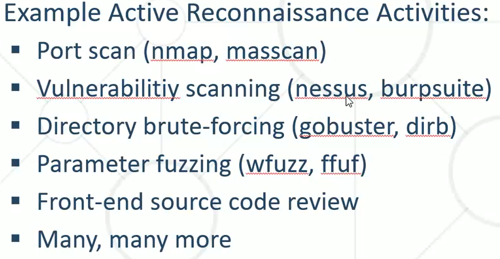
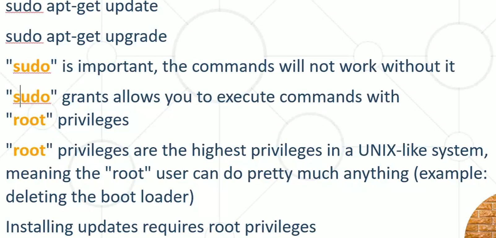

## 1.1 Какво е Reconnaissance (разузнаване)
**Reconnaissance (разузнаване)** — използване на технически знания и креативност за получаване на публично достъпна или лична информация за даден **Asset (актив/цел)**.
- Това е **първата стъпка** в реалните ангажименти и операции.
- 🎯 Най-важната стъпка в **Penetration Testing / Red Teaming** — задълбоченото разбиране на целта води до намиране и експлоатиране на уязвимости.

👉 **Technique → Tool (техника → инструмент):** инструментът изпълнява техниката. Идеята е да сме добри в **намирането и изпълнението на техниката**, а не просто в един инструмент.

## 1.2 Видове разузнаване

| Тип | Описание | Трафик към целта |
|---|---|---|
| **Passive Reconnaissance (пасивно)** | Събиране на информация чрез **OSINT – Open Source Intelligence**; напълно скрито (Stealthy), през **Third Party (трета страна)** | ❌ Не генерира трафик към целта |
| **Active Reconnaissance (активно)** | „Агресивни“ инструменти — Scanners, Fuzzers и др.; питаме и получаваме отговор | ✅ Генерира много трафик |

- **OSINT** — набор от техники и инструменти за получаване на информация напълно скрито.
- 👉 Нарича се *Passive*, защото **не е забележимо за целта**.

## 1.3 Основи на Linux / терминал
| Команда | Описание |
|---|---|
| `sudo apt-get update` | Обновява **списъка** с източниците на софтуер (откъде ще се вземе) |
| `sudo apt-get upgrade` | **Изтегля и инсталира** софтуера от обновените източници |
| `sudo` | = Run as Administrator |

- 💡 Поне веднъж месечно е добре да се пуска update.
- **Root = Admin** (най-високи права).
- Windows → **Partitions (дялове)** (C:, D:); Linux → всичко тръгва от **root** (дървовидна структура).

