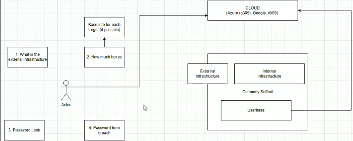
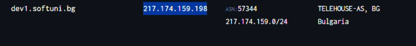
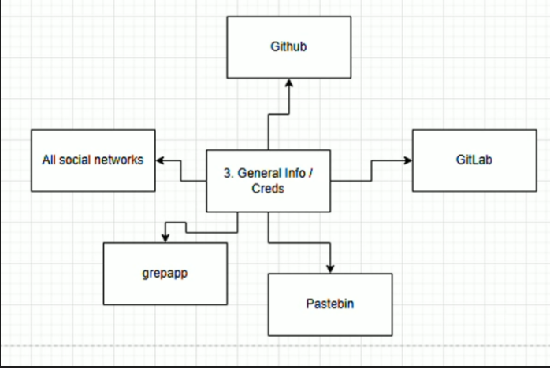

👉 Винаги започваме с **Passive Recon (OSINT)** — мисли върху **техники и теории**, не върху инструментите. Информацията се взима през трета страна, без да сме забележими за целта.

## 2.1 Какво има всяка компания
| Компонент | Примери |
|---|---|
| **Internal Infrastructure (вътрешна инфраструктура)** | Сървъри, networking, DNS сървър, email сървъри, Endpoints |
| **External Infrastructure (външна инфраструктура)** | Firewall, Endpoints |
| **Userbase (потребителска база)** | Хората в компанията; скрити ресурси (SharePoint, вътрешни документи) |
| **Cloud** | Малко компании са изцяло On-premise |

## 2.2 Цели на Passive Recon
**Инфраструктура:**
- Каква е външната инфраструктура? (Cloud / On-premise, Firewall)
- Колко машини (цели) имат? (Windows/Linux, DNS, Email сървъри — да мапнем средата)
- Имат ли **Cloud** (Azure, AWS, Google)?

**Хора:**
- **Password Leak (изтекли данни)** — парола, SSH ключ, сертификати, потребителски имена, имейли от отворени източници (Pastebin, GitLab, Bitbucket).
- **Password Breach (пробив с пароли)** — напр. dehashed.

## 2.3 Какво е DNS
**DNS – Domain Name System** — протокол, който мапва **Domain (домейн) → IP Address**. Идеята е да работим с имена вместо с числа.

| Запис | Сочи към |
|---|---|
| **A** | Domain → IP (IPv4) |
| **AAAA** | Domain → IP (IPv6) |
| **MX** | Mail server (пощенски сървър) |
| **NS** | DNS сървъра на компанията |
| **TXT** | Текстова информация |

- 💡 От **DNS Dumpster** се взима публична информация **без нито една заявка към целта**: колко машини имат, инфраструктура, къде се хостват, IP адреси.

## 2.4 Техники за намиране на уязвимости
**What is the infrastructure? (каква е инфраструктурата)**
- **DNS Scanning / Whois** — host, локация. Инструменти: DNS Dumpster, Metasploit модули, `nslookup`, Google.

**How many boxes? (колко машини)**
- **DNS Scanning** — брой машини, информация за тях, как са регистрирани, IP адреси. Инструменти: DNS Dumpster, Amass (не е passive), MXToolbox.

💡 Добри практики:
- Винаги опитвай достъп до машина през **domain name и IP**, първо `http`, после `https` — за да провериш дали няма две отделни приложения на различни портове.
- Винаги проверявай версията на приложението в **Git**.
- Винаги при видяна версия/софтуер проверявай за уязвимости на тази версия.
- Чети **коментарите в кода**.
- Фокусирай се върху тези с „различно име“ — `dev`, `qa`, `auth`.
- Когато видиш **API**, добавяй `swagger`.

| Порт | Услуга |
|---|---|
| **HTTP** | 80 |
| **HTTPS** | 443 |

Чести default данни: `Admin` / `Admin`, `qwerty123`.

## 2.5 Видове атаки върху идентичност
| Атака | Описание |
|---|---|
| **Brute Force (груба сила)** | Много пароли, малко потребители |
| **Password Spray** | Малко (често срещани) пароли, много потребители |
| **Mail Relay** | Уязвимост, която позволява да **Impersonate (се представиш за)** определен човек/имейл |
| **Password / Credential Leak** | При наличен username/email — търсим каква информация е изтекла |

## 2.6 Passive Recon инструменти
| Инструмент | Предназначение |
|---|---|
| **Maltego** | Събира информация и я прави на графики (💡 Obsidian е по-добър за записки) |
| **Discover** | Автоматизиран OSINT |
| **OSINT Framework** | Колекция от OSINT източници |
| **Shodan** | База данни и търсачка за уязвими устройства |
| **DuckDuckGo / Bing / Google** | Търсачки |
| **„Google Hacking“ / Google Filters** | Специфични заявки за детайлна информация от Google |
| **`nslookup`** | Дава IP адрес от даден домейн |

📚 **Homework:** DNS Dumpster, OSINT Framework.

