## 3.1 Въведение
**Active Recon** — задълбаваме в информацията от Passive Recon и използваме техники и инструменти, за да извлечем още повече информация за уязвимостите.

**Passive Recon Workflow:**

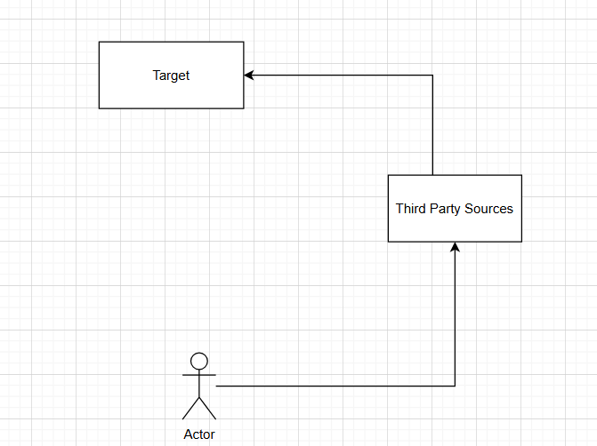

**Methodology (методология)** — стъпков процес, който гарантира, че сме събрали максимално информация и имаме най-голям шанс да открием най-много уязвимости. Всеки гради своя методология — да планираш и да знаеш какво правиш на всяка стъпка.

**Penetration Testing Workflow:**

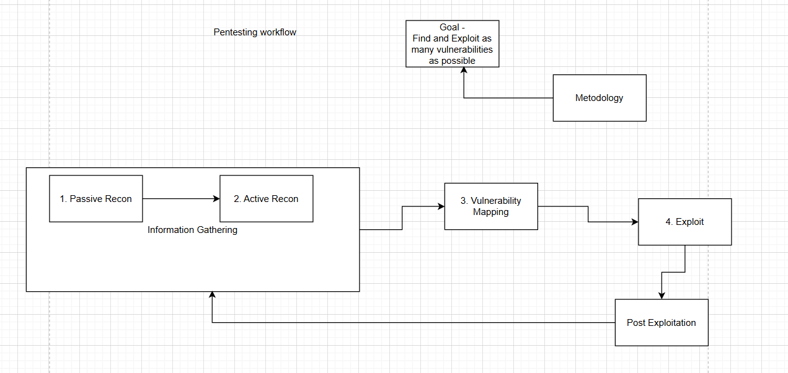

👉 Една атака е стъпков процес от прецизно подбрани действия:
- **Information Gathering = Passive + Active Reconnaissance**
- **Vulnerability Mapping** — на базата на събраната информация търсим уязвимости. „Мапване“ = откриване на всички портове, на които сървърът слуша, и всички уязвимости в системата.
- **Exploit** и **Post Exploitation** — последните стъпки.
- След това целият процес започва отново в друга среда (пробитата мрежа / логнатия потребител).

## 3.2 Обяснение

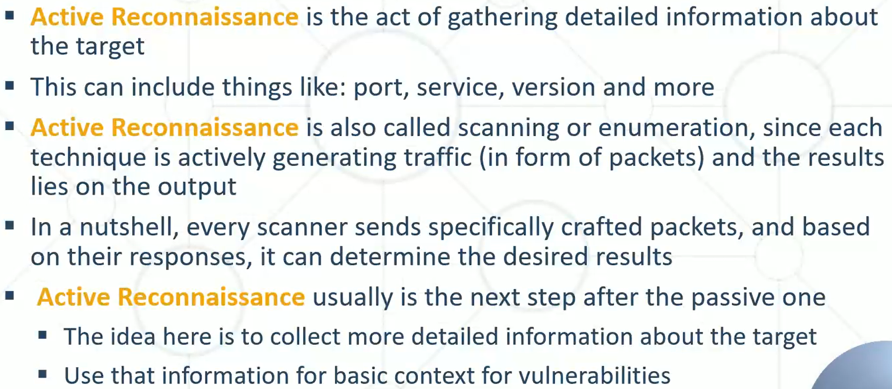

👉 Компютрите комуникират с **пакети**: пращаме пакет на сървър/машина и той връща пакет с информация. Това е същината на Active Recon — **питаме и получаваме отговор**.

## 3.3 Техники — портове и сканиране
**Какво е Port (порт)?**
- Машина, която хоства нещо, окупира определен порт. Ако машина стартира **Apache** и хоства уеб приложение, можем да комуникираме с нея по определен протокол.
- Няма достъп до сайт без да е хостнат — трябва сървър. Други услуги: SSH, FTP и др.
- 👉 **Port = врати и прозорци, през които някой може да мине.**

**Port Scan (сканиране на портове):**
- Разбираме какви услуги има на сървъра. Сървърът винаги има поне един отворен порт, иначе не можем да комуникираме с него.
- Отворените портове показват **по какъв начин можем да стигнем до системата** и да търсим уязвимости.
- 👉 Комуникацията винаги е **Client-Server** — сървърът отваря портове, клиентите се свързват към тях.

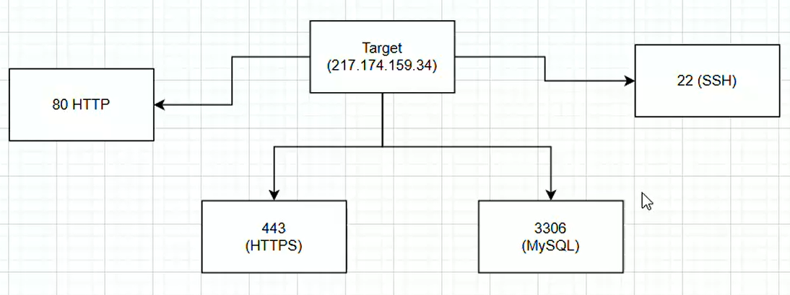

**Active Scan** — мапване на всички портове на системата.

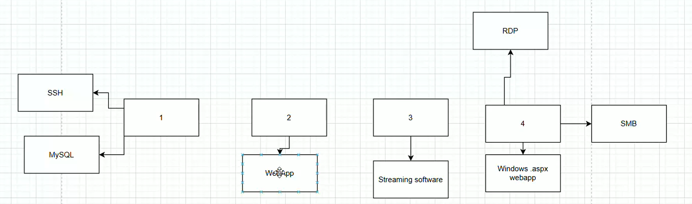

- Без Active Scan не можем да знаем тази информация. Винаги гледай всички най-важни портове.
- **Port Scan** — изпращат се пакети към машината и от пакетите се заключава дали портът е отключен.

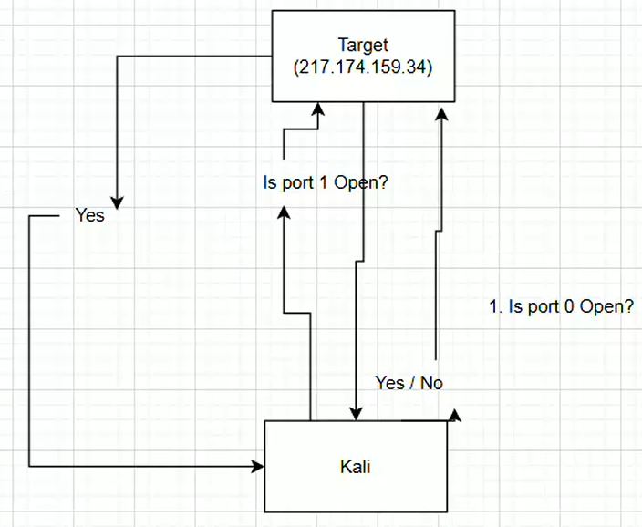

- **Max Ports — 65 535.** Една машина може да използва много портове.
- 💡 Правим scan на **всеки** порт, защото може да има скрити портове по-нагоре в системата.
- **Common / Default Ports** — почти винаги използвани портове (но не винаги). Например HTTP може да е отворен на нестандартен порт `59999`.

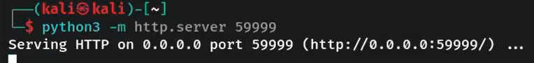

## 3.4 Nmap и други инструменти
**Nmap (Network Mapper)** — инструмент за port scan. Изпраща различни видове пакети и показва начините за комуникация с машината.
- **TTL (Time to Live):** над 120 → Windows; под 64 → Linux.

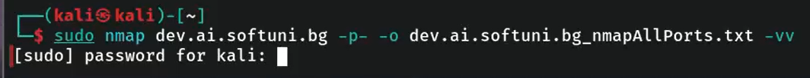

Параметри (от записките):
- `-vv` — по-детайлен изход.
- `-oN` / `-o` — запазва изхода във файл.
- `-p-` — сканира **всички** портове (не само default).
- 💡 Винаги използвай със `sudo` и винаги запазвай във файл. `cat` — преглед на файла.

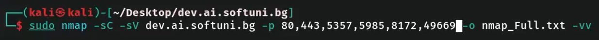

- `-sV` — информация за услугите (версии, плъгини).
- `-sC` — добавя **скриптове** → `-sC -sV` прави детайлен scan.

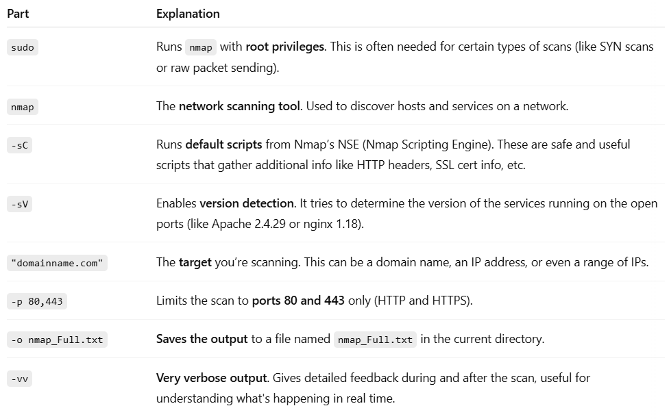

| Инструмент | Предназначение |
|---|---|
| `sudo vim /etc/hosts` | 💡 Добавяне на домейни локално → bypass. На един сървър може да има много хостнати приложения, за които основният домейн знае, но нашият DNS — не; за да ги достъпим, ги добавяме тук |
| **`curl`** | Пуска уеб заявка (като браузър) и показва какво се връща на ниво пакет |
| **Netcat / `nc`** | Прави „всичко“; също и port scanning |
| **`dirbuster` / `dirb`** | Brute force на директории и файлове |

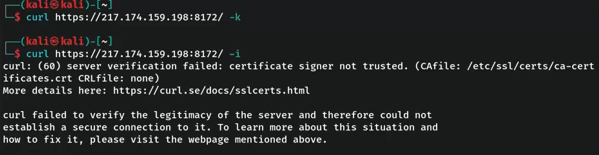
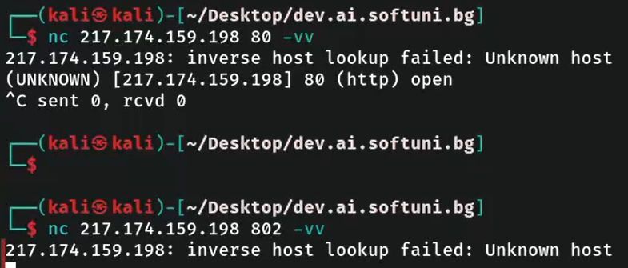
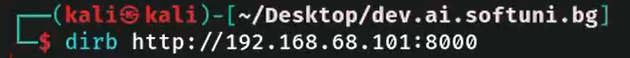

Други инструменти: **Nikto**, **Nuclei**.

👉 Идеята на Active Recon е да влезем едно ниво по-навътре — не само уеб приложения (HTTP), а и FTP, DB, SSH и др. Повечето услуги се тестват по-лесно от HTTP (за HTTP има отделен курс). Идеята на **Firewall** е да лимитира услугите в мрежата. ⚠️ Всеки active инструмент генерира много трафик.

