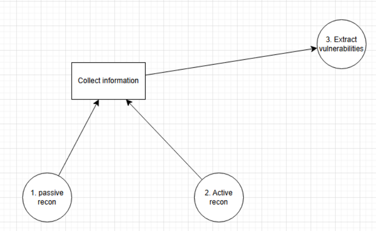
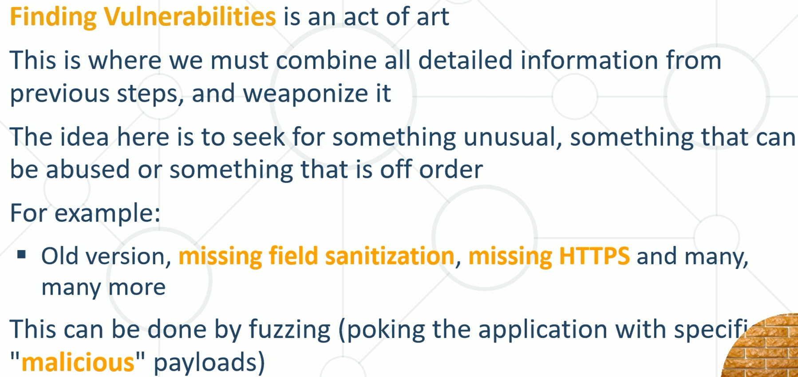
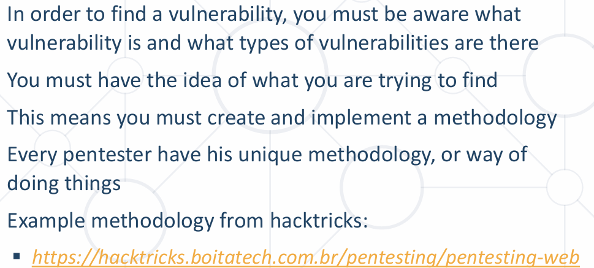

📌 Ресурс: **80, 443 — Pentesting Web Methodology | HackTricks**.

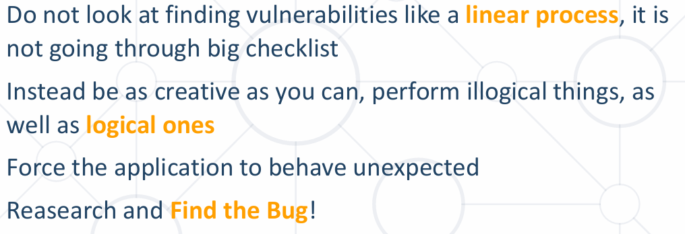

🎯 Важно:
- `nmap -sC -sV` прави детайлен scan + показва версия + добавя скриптове.
- При видяна версия — винаги проверявай дали е най-новата. Стара версия може да е **Exploitable**.
- **Missing HTTPS** — винаги докладвай, ако приложението е HTTP. Уеб винаги трябва да има сигурност (**TLS/SSL сертификат**).
- **Missing Field Sanitization (липса на валидиране на полета)** — където има поле: `'`, HTML tag, `<script>`.
- **SQL Injection**.

## 4.1 Fuzzing
**Fuzzing** — процес, при който навсякъде, където можем, слагаме определени **Payloads (полезни товари)**, за да видим как системата реагира при стрес.
- 👉 Даваме много payloads, за да видим как реагира (напр. при FTP). Проверяваме как сървърът ще работи в определени ситуации.

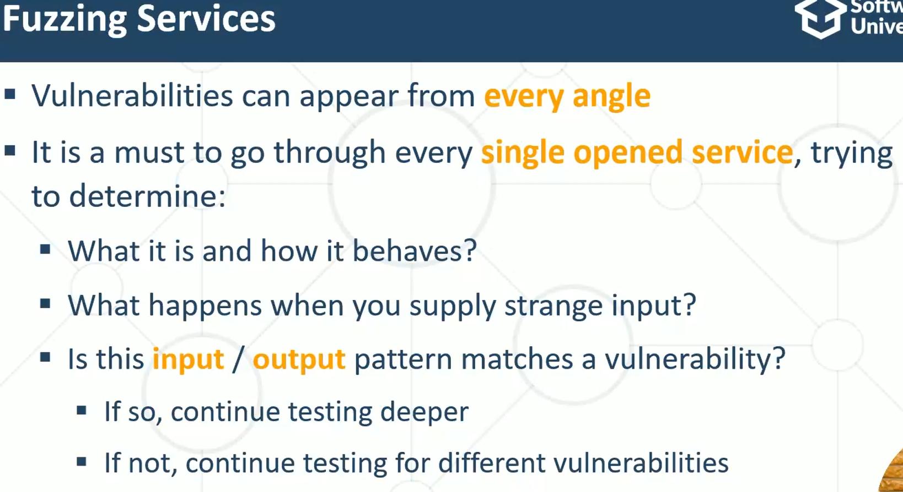
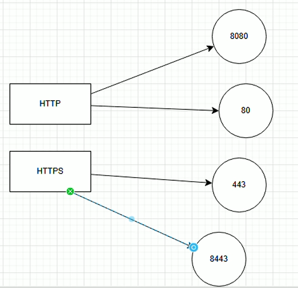

- 💡 Fuzzing е много полезен за уеб приложения. Може да имаме приложения на различни портове.

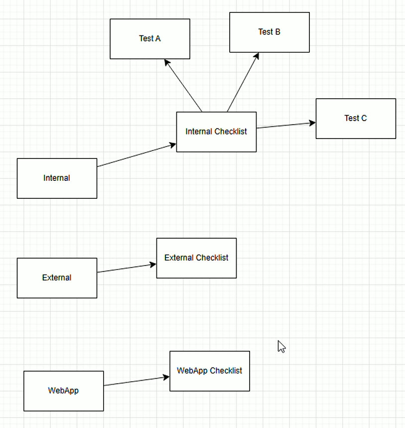

## 4.2 Checklist
- За всеки pentest има **Checklist**, който го има във всеки проект, но винаги първо тествай сам.
- Checklist-ът дава „контрол на качеството“ — тествай с пълна креативност, а накрая провери checklist-а, ако си изтървал нещо.
- 👉 Checklist-ът е **bare minimum (минимумът)**.

## 4.3 Техники

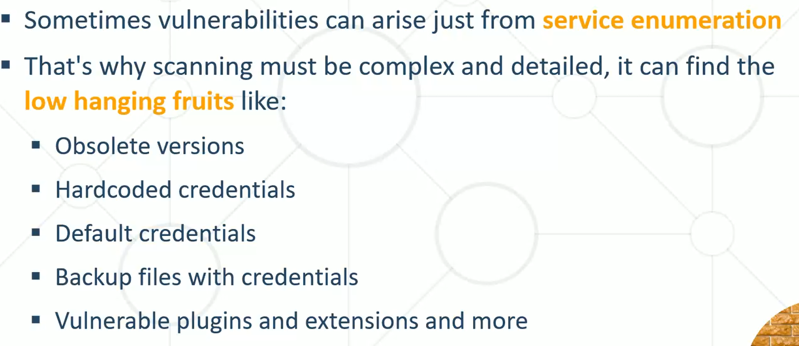

**Low Hanging Fruits (лесните неща):**

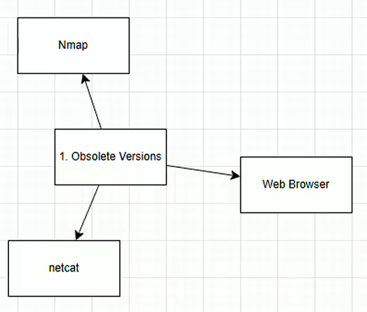
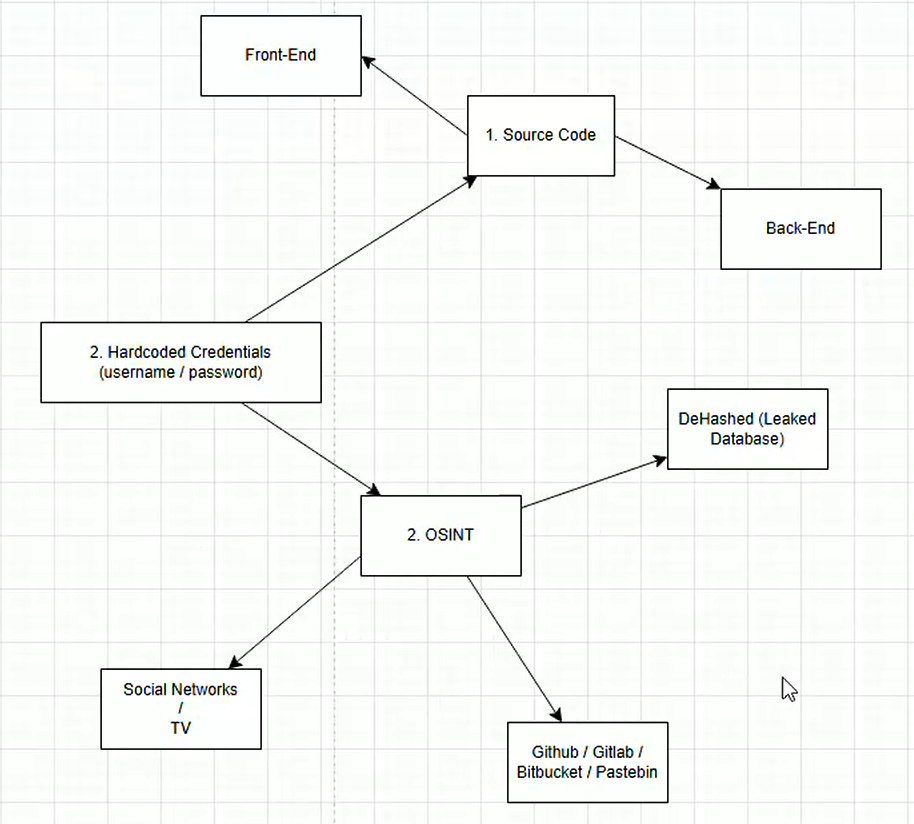

- **Default Credentials** — `admin/admin`, `anonymous/anonymous`, `qwerty/qwerty`.

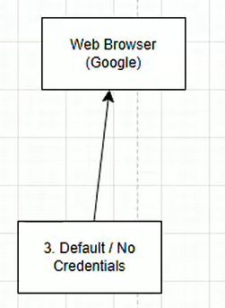

- **Backup Files** — винаги искаме да вземем и изследваме backup. 💡 Винаги се оглеждай за backup файлове.

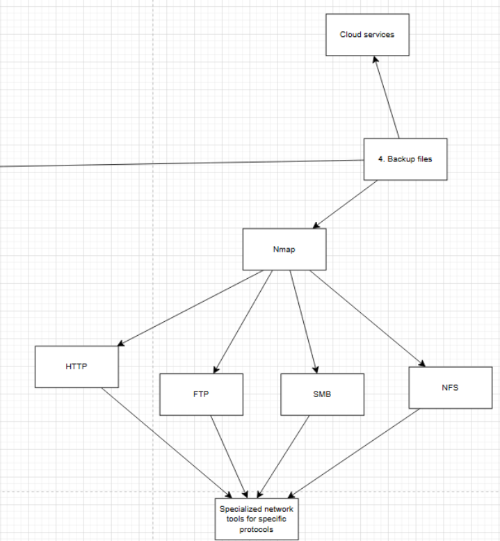

**Mind Map за тестване на FTP услуга:**

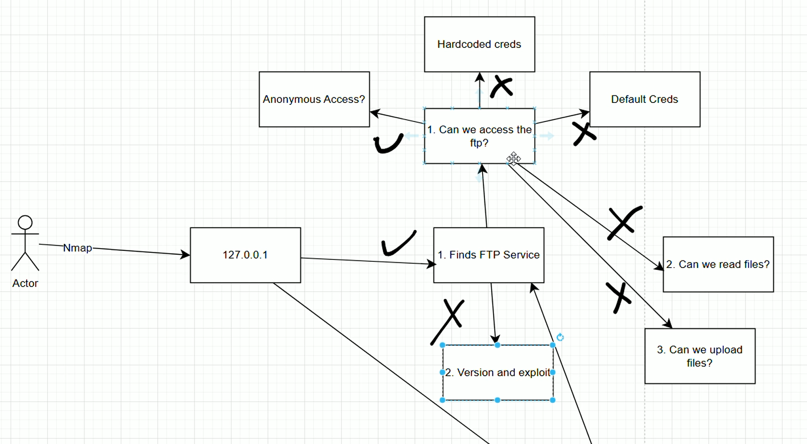
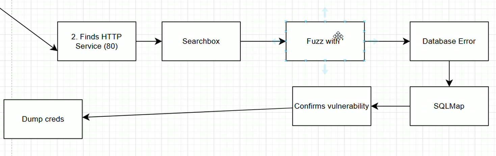

## 4.4 Инструменти за Active Recon
| Инструмент | Предназначение |
|---|---|
| **SearchSploit / Exploit-DB** | База данни от публично достъпни exploits. В Kali — `searchsploit`. Винаги проверявай тук при видяна версия (също и в GitHub) |
| **sqlmap** | Инструмент за SQL injection |
| **Web Browser** | Също възможност за търсене на уязвимости |
| **Burp Suite** | Уеб уязвимости |
| **Nessus** | (за следващ път) |

