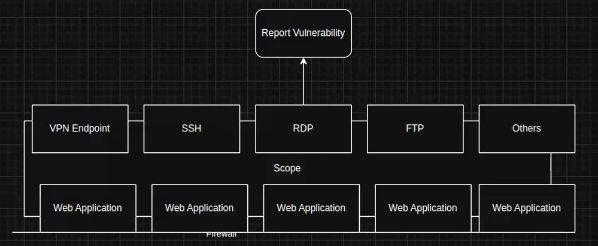
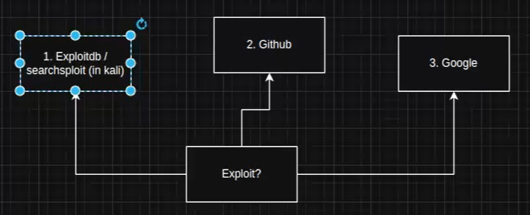
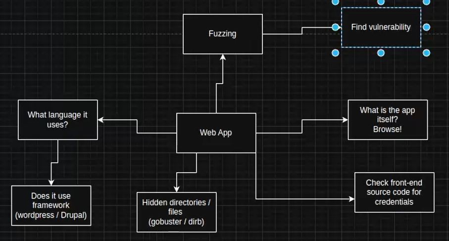

**Web Application** — най-използваната услуга.

- **RDP (Port 3389)** — ако е **Exposed (изложен)** → докладвай!
- **Уязвимост** — лошо написан код. Друг вид е при хората — **Phishing**. Версиите премахват уязвимости — затова при видяна версия я проверявай в Exploit-DB / GitHub / GitLab / Google.
- **CVE** — номерът на уязвимостта.

## 5.1 Разбиране на уязвимости
Първите неща за уеб приложение:
- На каква технология е писано.
- Да го fuzz-нем за някои от атаките.

🎯 Цел на курса: **Reconnaissance (търсене) → намиране на информация → намиране на exploit-и**.

- **BeeBox** — система за тестване на уязвимости.
- 💡 Tip: когато си **stuck (блокирал)** — продължавай с Recon!
- 💡 Tip: при видяна версия — винаги проверявай в Exploit-DB / Git / Google!

