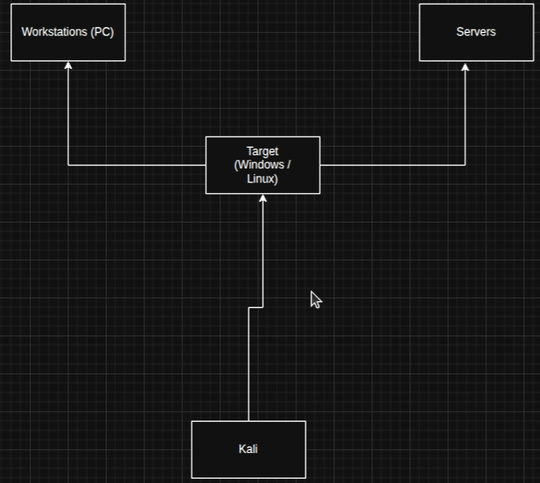
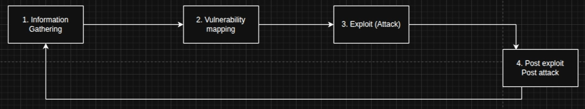
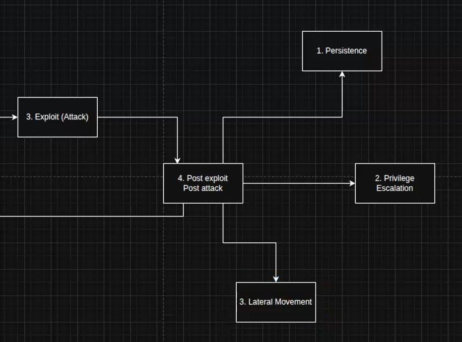
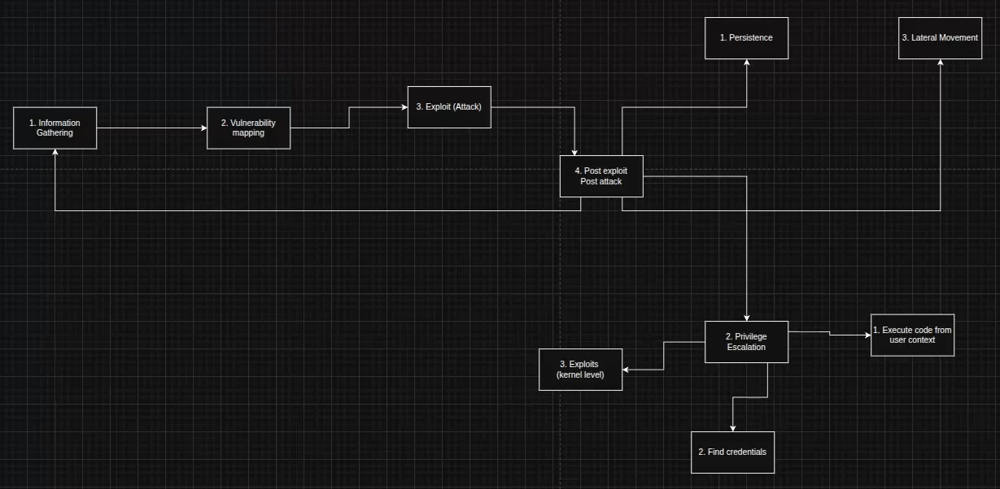

## 7.1 Видове цели (Targets)
| Цел | ОС |
|---|---|
| **Workstations / PC** | Linux / Windows (повечето — Windows) |
| **Servers** | Linux / Windows, различни дистрибуции (повечето — Linux) |

👉 Разликата: зад Workstation седи човек, а сървърът е **User-less (без потребител)** — свързваме се през RDP, SSH. В **95%** от случаите достъпваме системите през **CLI**.

🎯 За изпита: браузърът отваря само **1 порт — 80**! Трябва да направим port scan и да опитаме връзка през някой порт с `nmap` / `dirbuster` / `gobuster`.

**Стъпки за една атака:**

- 💡 Когато не знаем нещо — най-вероятно нямаме достатъчно информация!

**Full Graphic:**

