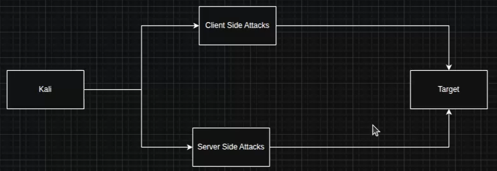
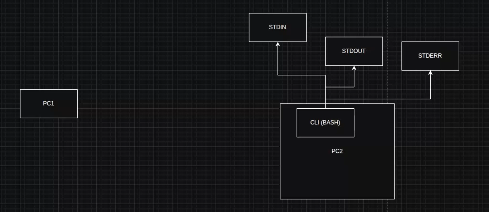
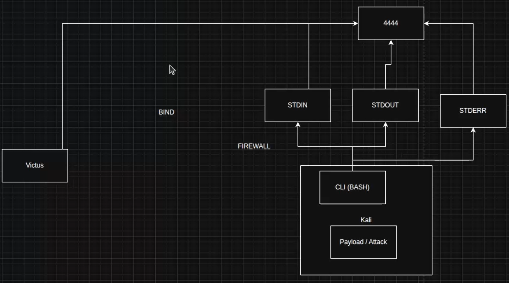
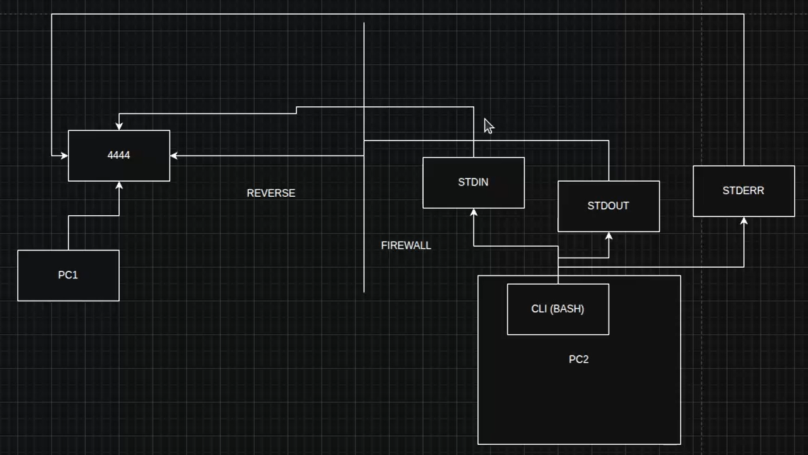
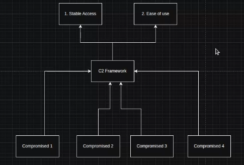

👉 Metasploit е **Exploitation и C2 Framework в едно**.

| Тип атака | Описание |
|---|---|
| **Client-side Attack** | Атакуваме хората в компанията (напр. phishing email) |
| **Server-side Attack** | Атакуваме инфраструктурата (напр. DoS/DDoS) |

Metasploit е инфраструктура, която позволява достъп до инфраструктура.

| Команда | Описание |
|---|---|
| `ss -nltp` | Показва всички отворени портове на нашата Linux система |
| `ifconfig` | Показва IP адресите на нашата система |

👉 Идеята е да пренасочим стандартните изходи (Output) към нашата система.

**Bind Model** на комуникация — не се използва често, защото Firewall обикновено е настроен правилно:

**Reverse Shell:**

**Какво дават C2 платформите?** (Mythic / Havoc / Metasploit)
- **C2 Platform – Command and Control** — платформа, която управлява достъпа и дава допълнителни функционалности.

👉 **Metasploit = C2 Platform + Exploit Framework.**

