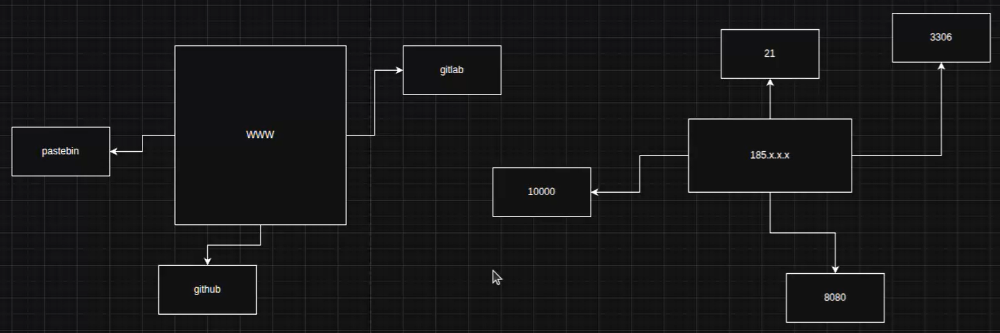

- Изпитът е от **10:00 до 16:00** (практически, 6 часа, форма като **CTF**).
- Ще има **report template**.
- 🎯 Идеята е само да **търсим уязвимости**, не да правим exploit-и.
- Какъвто и да е Objective-ът — **докладвай всички уязвимости**.
- За да минем: анализираме машината и търсим в Web за ключове, пароли и т.н.

🎯 Указания:
- Възможно е лекторът да „скрие“ парола, ключ и т.н.
- Възможно е да **няма приложение** (без 80 / 443).
- `nmap` / masscan — да се пробва преди всичко.
- Може да има оставен **MD5 hash** (или друг) → дехешира се с **CrackStation**.
- Детайлен scan на username/email → **user finder / Sherlock** → провери в GitHub / GitLab / Pastebin.
- Проверявай и предишните **commits**.
- ⚠️ **Без DoS и агресивни scans!** Без автоматизирани exploit инструменти (Nessus, Nuclei, Nikto, Burp Scanner) — те DoS-ват.
- Може да пуснеш `dirbuster` / `gobuster`.
- Оценката зависи от това дали сме намерили **Objective-а**. Теорията — според лектора не е проблем.

🎯 За изпита:
- Хубав port scan с всички показани атрибути и команди.
- Добро използване на Google и ChatGPT.
- Детайлен анализ на всеки nmap scan; при ново IP → детайлен scan (`-p-`) за всички портове.
- 📚 „Книгата за Linux“ — ако се прочете, не трябва друг курс за Linux.

💡 Как да се подготвя:
- Setup на **Kali + BeeBox**.
- Мини веднъж през теорията.
- Научи се да правиш Port Scan.
- Мини през всяка атака от документа.
- Допълнително: **XSS, HTML Injection, Cross-Site Scripting, Front-end code review, Source code review (Git)**.
- Подготви **Default Credentials List**.

