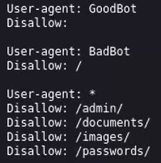
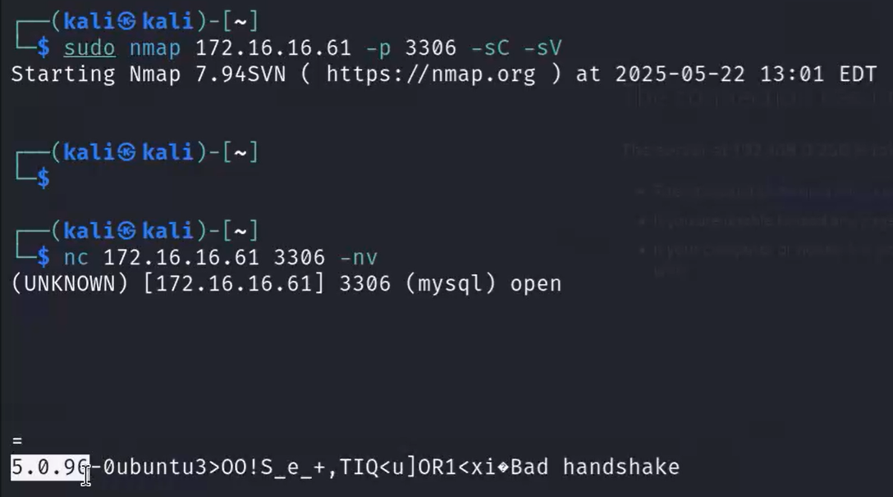
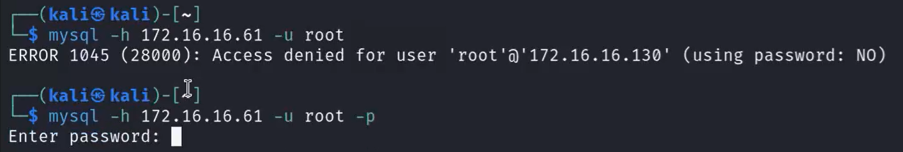
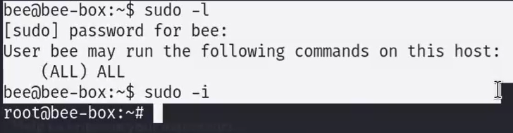

## Outdated Software (остарял софтуер)
- Винаги докладвай остарял софтуер.
- Версия може да има на всичко — приложение, ОС. Понякога стига `nmap` scan или ръчно с `netcat` / `telnet`.
- Търсене на exploit: напр. `CVE-2012-1823 poc github`.

## Information Disclosure (разкриване на информация)
- Всяка информация, която дава **Attack Vector (вектор на атака)**.
- Всичко намерено — Pass, username, email, artifact, log файлове, конфигурация — е Information Disclosure.
- 💡 Пусни `dirbuster` / `gobuster`.
- 👉 Най-добрата конфигурация е тази, която **не показва версия**.
- Проверявай **`robots.txt`**.

## SQL Injection
- Докладвай.
- Слагай специфични символи при видяно поле (провери ги в интернет).
- При полета винаги си струва да тестваш за SQL Injection.

## Default Login Attempts
- 💡 Имай лист с 10–20–30 default usernames & passwords.

## Directory Traversal
- Важно е да знаем **коя ОС** се използва — payloads са различни за Linux и Windows.
- Винаги пробвай за **XSS / Cross-Site Scripting / HTML Injection** при видени полета.

