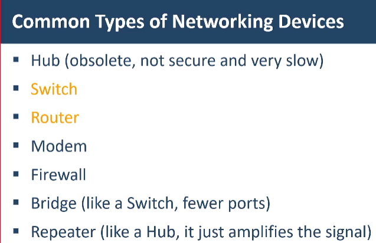

**Network (мрежа)** — множество устройства (принтери, лаптопи, телевизори…), свързани заедно с цел **комуникация и споделяне на ресурси**.
- Свързването е чрез **кабел** (към **Switch / Hub**) или **безжично** (**WAP – Wireless Access Point**). Дори безжичните устройства могат да се свържат към WAP с кабел.
- За да споделят информация, устройствата трябва да „говорят на един език“ — комуникират чрез **Protocols (протоколи)**. Обикновено се използват няколко протокола за една задача.
- 👉 **Ethernet** е най-често използваният протокол в кабелните мрежи.
- Устройствата в мрежата наричаме **Nodes (възли)**.

| Устройство | Статус |
|---|---|
| **Hub (хъб)** | Старо устройство |
| **Switch (комутатор)** | Модерно и често използвано |

Всички мрежи са различни по размер:
- **SOHO (Small Office / Home Office)** — малка (обикновено домашна) мрежа.
- **LAN (Local Area Network)** — мрежа в локална зона (напр. офис).
- **WAN (Wide Area Network)** — свързва мрежи, които са географски отдалечени.

