## 2.1 Какво е OSI
**OSI – Open Systems Interconnection (взаимно свързване на отворени системи)** — концептуална рамка/стандарт, който описва как информацията от софтуер на един компютър се изпраща през мрежата до софтуер на друг компютър. Голямата задача е разделена на **7 слоя (Layers)**, като всеки отговаря за определена задача и получава информация от слоя под и над него.
- 👉 Производителите на мрежово оборудване използват OSI при проектиране на хардуер, ОС и протоколи.
- 👉 Общ „език“ в IT — помага при **Troubleshooting** и при обяснение къде е проблемът.
- Слоевете реално са смесица от **card drivers, ОС, приложения и мрежов хардуер**.

## 2.2 Седемте слоя

**Мнемоники:**
- Отгоре надолу (7→1): *All People Seem To Need Data Processing*
- Отдолу нагоре (1→7): *Please Do Not Throw Sausage Pizza Away*

| # | Layer (слой) | Роля | Примери / ключови думи |
|---|---|---|---|
| **7** | **Application (приложен)** | Мрежови услуги за крайния потребител | HTTP/S, FTP, DNS, POP3, SMTP, SSH |
| **6** | **Presentation (представителен)** | Форматиране на данните, **Encryption (криптиране)**, компресия | JPG, ASCII, **SSL**, EBCDIC |
| **5** | **Session (сесиен)** | Установяване, поддържане и прекъсване на **Session (сесия)** | Half-duplex / Duplex, контролни точки |
| **4** | **Transport (транспортен)** | Как и къде се доставят данните; **Segmentation**, Flow Control, Error Control | **TCP / UDP** |
| **3** | **Network (мрежов)** | **Routing (маршрутизация)**, логическо адресиране | **IPv4 / IPv6**, рутери |
| **2** | **Data Link (каналния)** | **MAC адреси**, „switching“ слой; LLC + MAC подслоеве | Switch, Frames |
| **1** | **Physical (физически)** | Сигнали, кабели, конектори, топология | Ethernet кабел, RJ45, битове |

## 2.3 PDU – Protocol Data Unit (единица данни)
Името на данните на всеки слой. Мнемоника: *Bacon Frying Produces Salivation*.

| Layer | PDU |
|---|---|
| Physical 1 | **Bits (битове)** |
| Data Link 2 | **Frames (кадри)** |
| Network 3 | **Packets / Datagrams (пакети)** |
| Transport 4 | **Segments (сегменти)** |
| Layers 5–7 | **Data (данни)** |

👉 **Encapsulation (капсулиране)** — надолу по стека всеки слой добавя своята информация (header). **Decapsulation (декапсулиране)** — нагоре по стека всеки слой премахва добавеното от едноименния слой при изпращането. Така накрая съобщението се сглобява в оригиналния си вид.

## 2.4 Детайли по слоеве

**Physical Layer 1** — превръща нулите и единиците (битове) в **сигнали** (електрически при мед, светлинни импулси при оптика, електромагнитни вълни при безжични). Wiring Standards (RJ45 — 8 жици), AMI (Alternate Mark Inversion).

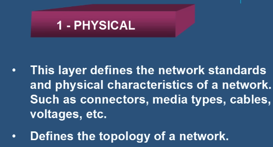

**Data Link Layer 2** — основният мрежов „език“; **MAC (Media Access Control)** — физическо адресиране; **LLC (Logical Link Control)** — логическа топология. Добавя MAC адрес → данните стават **Frames (кадри)**. 🎯 MAC адресът е „изгорен“ на всяко устройство и е глобално уникален.

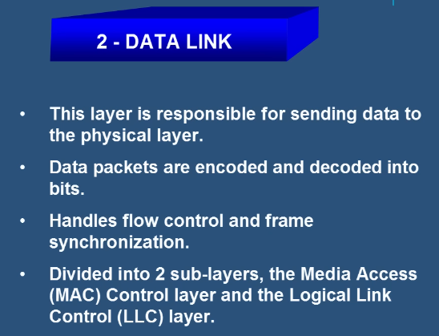

**Network Layer 3** — „routing“ слой; логическо адресиране (**IPv4/IPv6**), Connection Services, **Path Determination (избор на най-добрия път)**. Тук работят рутерите.

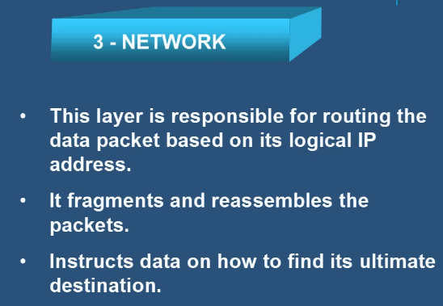

**Transport Layer 4** — „пощата“; описва как и къде се доставят данните.

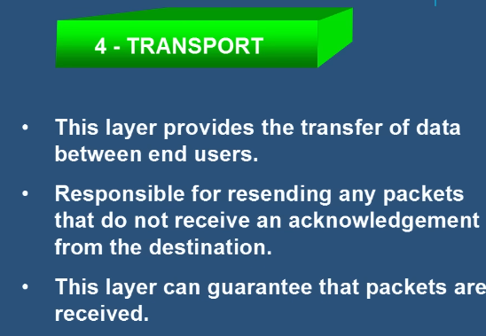
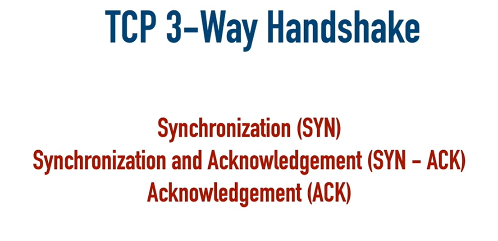

- **Segmentation** — данните се разбиват на **Segments (сегменти)**; всеки съдържа **Sequence Number** (за подредба) и **Port Number** (за правилната апликация).
- **Flow Control** — управление на обема данни (бавен получател казва на бърз сървър да намали скоростта).
- **Error Control** — при неправилно предадена информация се прави заявка за повторно изпращане.

| | TCP – Transmission Control Protocol | UDP – User Datagram Protocol |
|---|---|---|
| Тип | **Connection-oriented (връзково-ориентиран)** | **Connectionless (безвръзков)** |
| Надеждност | Висока (**Three-Way Handshake**: изгражда връзка → изпраща → получава отговор) | По-ниска, но по-бърз |
| Употреба | Там, където е важна целостта | Voice & Video, по-кратки съобщения |

**Session Layer 5** — координира връзката: установява и прекратява диалозите приложение-приложение, съставя правила за обмен, поставя **контролни точки (checkpoints)**, контролира начина на предаване (Half-duplex / Duplex).

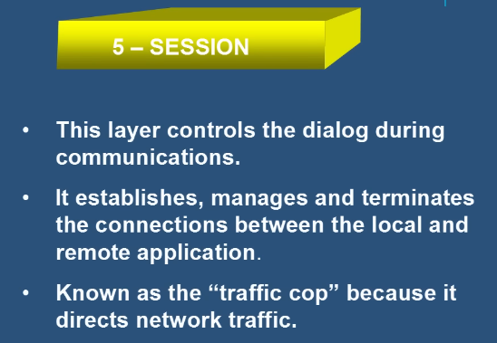

**Presentation Layer 6** — превежда данните в машинен код (ASCII), **компресира** (Lossy / Lossless) и **криптира** (**SSL** от страната на подателя, декриптира при получателя).

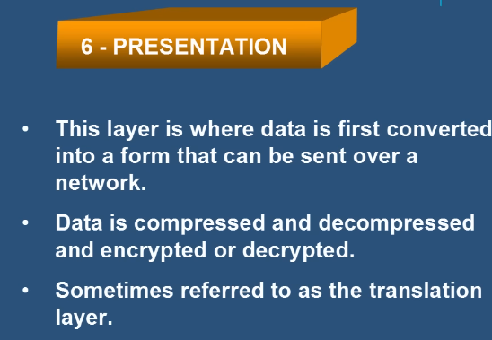

**Application Layer 7** — слоят, който потребителят вижда (web browsing, email, file transfer); идентифицира се с file extension (`.exe`, `.jpg`). Protocols: HTTP/S, FTP, SMTP, DNS, POP3.

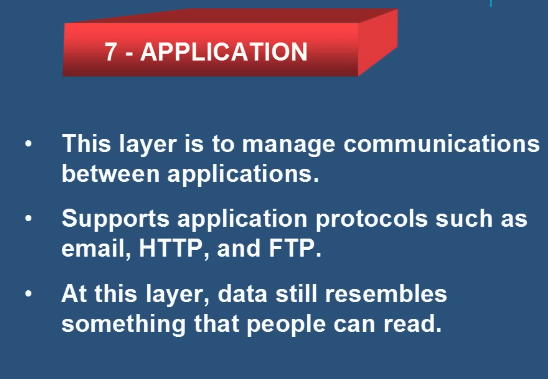
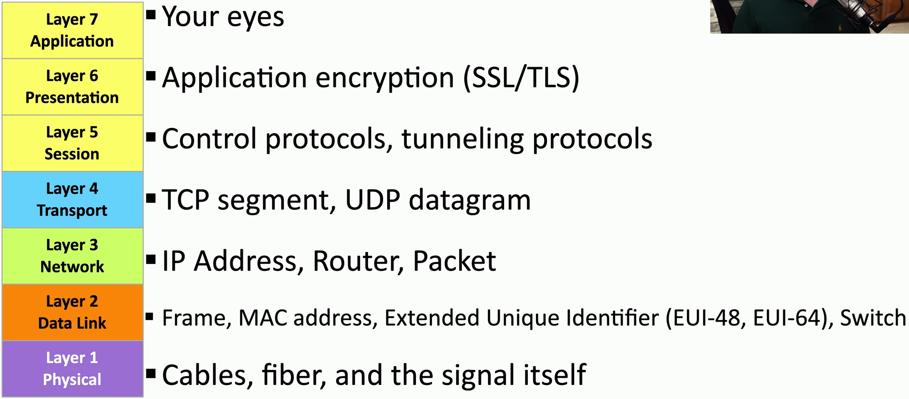
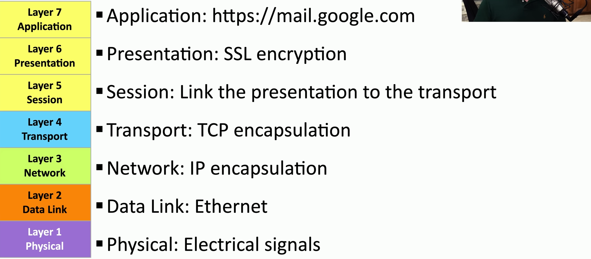

## 2.5 📌 Пример: отваряне на Gmail
- **Layer 7** — отваряме Gmail
- **Layer 6** — информацията се криптира
- **Layer 5** — свързва всичко от горните слоеве с трафика отдолу
- **Layer 4** — TCP транспорт
- **Layer 3** — IP адрес между нас и Google
- **Layer 2** — трафикът се капсулира в Ethernet frames
- **Layer 1** — сигнали

## 2.6 TCP Flags, Headers, MTU
- **Header Information** капсулира данните и казва на останалата част как да бъдат обработени.
- На Transport Layer 4 има **TCP Header** с **TCP Flags**; има флагове и в **IP Header (Layer 3)**.
- **MTU – Maximum Transmission Unit** — максимален размер на пакета.
- **Fragments (фрагменти)** — разбиване на информацията на по-малки части.

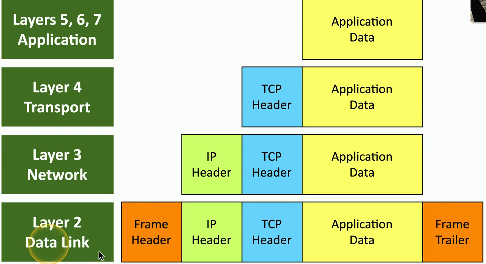
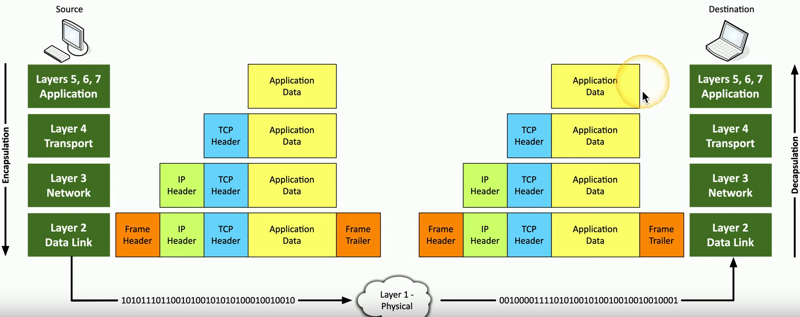

