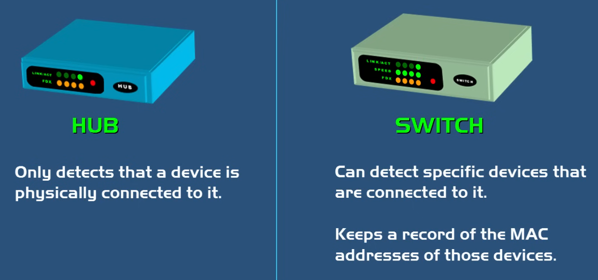
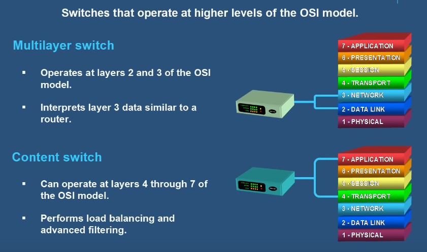
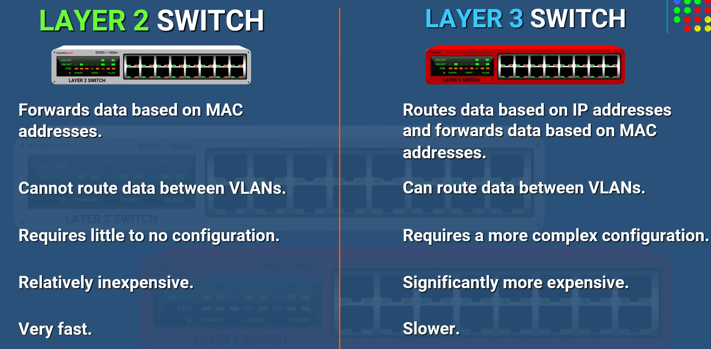

## 3.1 Modem vs Router
| | Modem (модем) | Router (рутер) |
|---|---|---|
| Роля | Докарва Интернет от **ISP**; **MOdulator-DEModulator** — преобразува analog ↔ digital сигнал | Насочва (routes) интернет връзката към всички устройства |
| Сигнали | Analog (от Интернет) ↔ Digital (компютър) | Работи с IP адреси |

- 💡 Ако имаме само един компютър, технически можем да премахнем рутера и да го включим директно в модема с Ethernet кабел.
- Видове модеми: **Cable** (коаксиален кабел) и **DSL**.
- ISP често праща **Modem + Router комбо** устройство. Повечето рутери имат вграден Switch.

## 3.2 Hub, Switch, Router
| Устройство | Layer | Интелигентност | Как работи |
|---|---|---|---|
| **Hub (хъб)** | 1 | ❌ „глупав“ | Препраща данните към **всички** портове (broadcast); усилва сигнала. Passive (без захранване) / Active. ⚠️ Излишен трафик и проблеми със сигурността |
| **Switch (комутатор)** | 2 (Multilayer — 2 и 3) | ✅ умен | Учи **MAC адресите** (има **MAC Address Table**) и праща данните към правилния порт |
| **Router (маршрутизатор)** | 3 | ✅ | Насочва данните между мрежи по **IP адреси**; „Traffic Police“; **Gateway** на мрежата; може да служи и като Firewall |

- 👉 Hub & Switch обменят данни **в рамките на LAN** — не четат IP адреси, затова не обменят данни извън мрежата.
- **Modem** — в този му вид също е остаряло устройство; преобразува цифров ↔ аналогов сигнал.

## 3.3 Други устройства и понятия
- **PoE – Power over Ethernet** — захранване през Ethernet кабела, без отделен контакт за ток.
- **Gateway (шлюз)** — свързва две мрежи; не променя данните, а само техния формат.
- **Bridge (мост)** — като Switch, но с два порта (Layer 2); разделя мрежата на различни **Collision Domains**.
- **Repeater (повторител)** — като Hub, но с два порта (Layer 1).

## 3.4 Layer 2 vs Layer 3 Switch
| | Layer 2 Switch | Layer 3 Switch |
|---|---|---|
| Слой | Data Link (MAC адреси) | Network (Network Layer) |
| Употреба | Дом и малки мрежи | Бизнес |
| Специфика | — | Позволява **Inter-VLAN Routing** (комуникация между VLAN-и) |

## 3.5 Wireless Access Point vs Wi-Fi Router
⚠️ Това **не са** едни и същи устройства.

| | Wi-Fi Router | WAP – Wireless Access Point |
|---|---|---|
| Какво прави | Свързва кабелни и безжични устройства в LAN; излъчва Wi-Fi + вграден Switch | Препредава данни между кабелна мрежа и безжични устройства („безжичен Hub“) |
| Връзки | Безжични **и** кабелни (има антена + Switch) | **Само безжични** |
| Firewall | ✅ (+ вграден DHCP) | ❌ (взима IP от рутера на организацията) |
| WAN порт | ✅ (свързва се с модем) | ❌ (свързва се към Wi-Fi рутер) |
| Употреба | Домове, малки офиси | Средни/големи организации (множество AP за цялата сграда) |

👉 В големи организации Wi-Fi рутерите създават проблем с **Manageability (управляемост)** — трябва да се логваш във всеки поотделно. С WAP управлението е централизирано и всички безжични устройства са в един Subnet.

## 3.6 Мрежови инструменти (хардуерни)
| Инструмент | Предназначение |
|---|---|
| **Cable Stripper** | Премахва обвивката на края на кабела |
| **Wire Crimper** | Захваща конектори към TP кабел |
| **Cable Tester** | Проверява Continuity (непрекъснатост) и подредбата на жиците |
| **Tone Generator** | Проследяване на кабел от единия край до другия |
| **TDR – Time Domain Reflectometer** | Тества TP и коаксиални кабели |
| **OTDR – Optical TDR** | За оптични кабели (по-сложни тестове от Light Meter) |
| **Light Meter** | По-прост инструмент от OTDR |
| **Loopback Adapter** | Loopback тестове за проблеми с мрежови портове |
| **Butt Set** | Тества и наблюдава телефонни линии |
| **Punch Down Tool** | Набива жици в Punch Down блокове |
| **Multimeter** | Електрически измервания (и за мрежи) |

