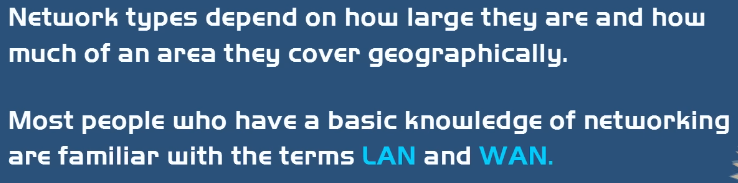
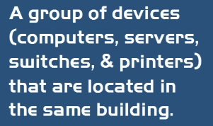

| Мрежа | Обхват | Описание |
|---|---|---|
| **PAN – Personal Area Network** | Лична | Bluetooth, IR, NFC, USB; смартфон, слушалки, фитнес телеметрия |
| **LAN – Local Area Network** | Сграда | Дом/малък бизнес; най-често **Ethernet LAN** със Switch |
| **WLAN – Wireless LAN** | Като LAN | LAN без кабели (Wi-Fi рутер или WAP) |
| **CAN – Campus / Corporate Area Network** | Кампус | Свързва няколко LAN в ограничена зона (университет с няколко сгради) |
| **MAN – Metropolitan Area Network** | Град | По-голям от CAN; няколко сгради, често **оптичен кабел**, висока скорост |
| **SAN – Storage Area Network** | Data Center | Специализирана мрежа за съхранение на данни |
| **WAN – Wide Area Network** | Държави/глобус | Най-голямата; свързва LAN/CAN/MAN; **Интернет е WAN**; по-бавна от LAN |

- **HAN – Home Area Network** — smart home.
- **WWAN / Wireless WAN** — 802.11 технологии, мобилност в ограничена зона.

## 4.1 Peer-to-Peer vs Client-Server
| | Peer-to-Peer (P2P) | Client-Server |
|---|---|---|
| Роли | Всяко устройство е **и Server, и Client** | Разделени; клиентите говорят със сървъра, няма client-to-client |
| Плюсове | Лесно разгръщане, ниска цена | Производителност, централизирано администриране и автентикация |
| Минуси | Трудно се подсигурява и администрира | Цена (нужен сървър), сложност |

> 📌 P2P е в основата на Bitcoin — плащания от потребител към потребител без финансова институция (от white paper-а на Satoshi Nakamoto).

## 4.2 NAS vs SAN
| | NAS – Network Attached Storage | SAN – Storage Area Network |
|---|---|---|
| Какво е | Устройство само за съхранение с NIC, закачено към Switch/Router | Специализирана високоскоростна мрежа за съхранение |
| Употреба | Домове, малки/средни фирми | Големи компании |
| Характеристики | ⚠️ Single Point of Failure | Fault Tolerant, споделени disk arrays, високо скалируем, свързан с **Fiber Channel**, скъп |

## 4.3 LAN / WAN / Subnet и Demarcation Point
- **Subnet (подмрежа)** — деление на по-голяма мрежа; разделя се чрез **Router**. Цели: Manageability, Security, Performance.
- **Gateway (Modem/Router)** — устройството от ISP, чрез което LAN става част от WAN.
- **Demarcation Point (dmarc, точка на разграничение)** — физическата точка, където се свързва мрежата на доставчика с вътрешната мрежа (вкъщи — телефонната кутия; в корпорация — локация в сградата).

## 4.4 Traffic Types (видове трафик)
| Тип | Описание |
|---|---|
| **Unicast** | 1 към 1 (един изпращач, един получател) |
| **Broadcast** | 1 към всички (неефективно и несигурно) |
| **Multicast** | 1 към група |
| **Anycast** | 1 към най-близкия от група |

