**Topology (топология)** — начинът, по който устройствата са свързани в мрежа. Полезна при планиране, проектиране и Troubleshooting. Най-разпространена е **Extended Star**.

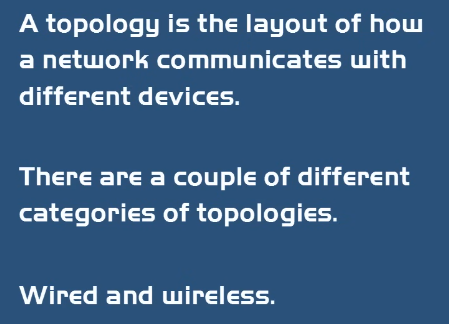

| Топология | Описание | Плюсове / минуси |
|---|---|---|
| **Star / Hub & Spoke (звезда)** | Всички устройства към централна точка (Hub/Switch) | Прекъсване на едно устройство не влияе на мрежата; ⚠️ централната точка е **Single Point of Failure** |
| **Ring (пръстен)** — Legacy | Всеки компютър свързан в кръг, с по един съсед отляво и отдясно | Лесно за инсталиране; ⚠️ прекъсване на един кабел спира цялата мрежа |
| **Bus (шина)** — Legacy | Всички устройства към един коаксиален **Backbone** чрез **BNC / T-connectors**; **Terminators** в двата края | Евтино; ⚠️ при липсващ/разхлабен Terminator → **Signal Reflection** |
| **Mesh (решетка)** | Всеки компютър свързан с всеки | Високо ниво на **Redundancy**; скъпо → основно WAN. 👉 Интернет е Mesh |
| **Point-to-Point** | Два хоста, директно свързани | Най-простата топология |
| **Client-Server** | Клиентите се свързват към сървър за общи ресурси | Централизирани ресурси |
| **Point-to-Multipoint** | Централна wireless станция (Access Point / Base Station) към много клиенти | Безжични outdoor мрежи |
| **Peer-to-Peer** | Всеки клиент комуникира с всеки | Домове, малки фирми |
| **Hybrid (хибридна)** | Комбинация от топологии | Повечето бизнеси |
| **Infrastructure** | Комбинация от безжични и кабелни устройства (подобна на Star) | — |
| **Ad hoc** | Всички устройства безжично свързани в прост P2P | — |

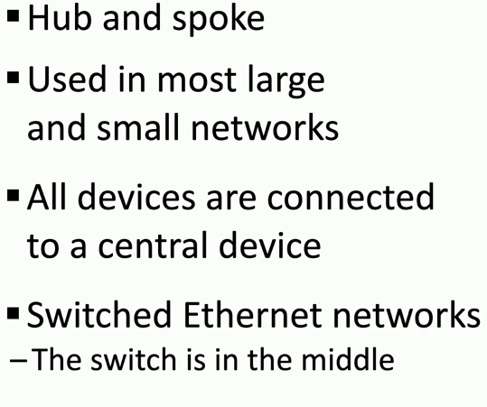
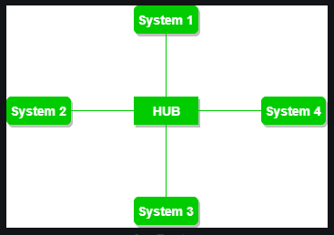
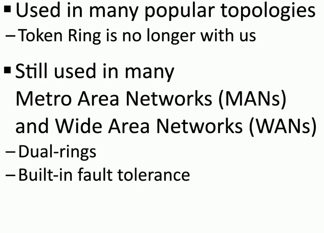
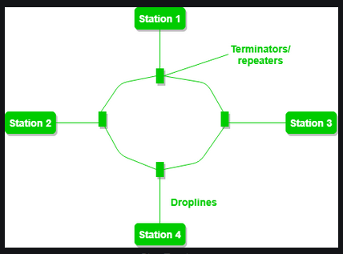
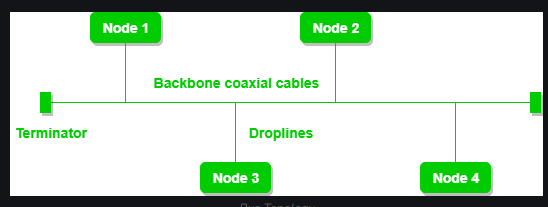
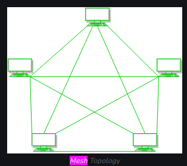
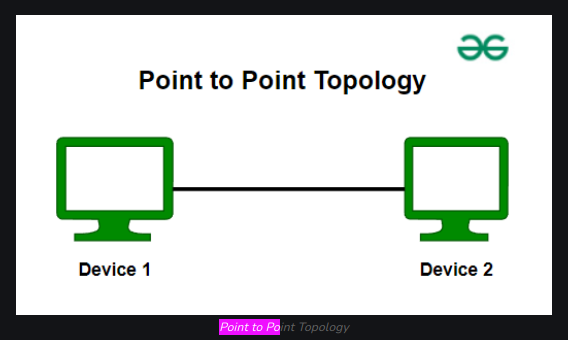
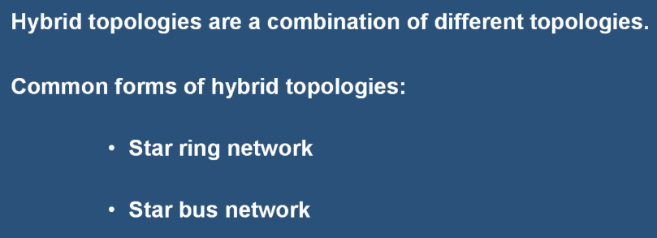
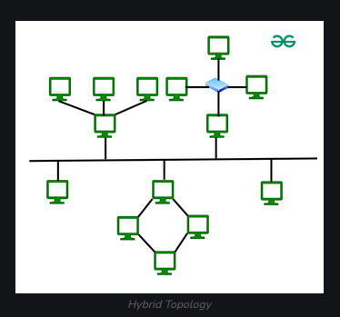
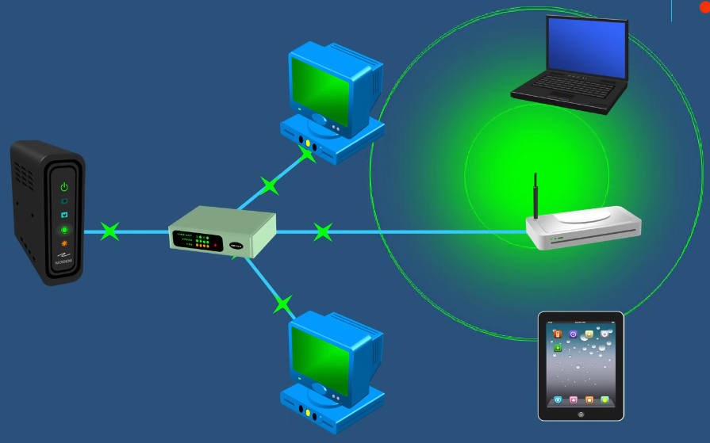

