## 6.1 Стандарти (802.11 от IEEE)
Днешни безжични стандарти за обмен: **A, B, G, N, AC** (+ по-новите **AX / Wi-Fi 6**).
- **Infrared (IR)** — данни чрез лъч светлина; ⚠️ слаб сигнал при препятствие, не работи на пряка светлина.
- **Bluetooth** — близки разстояния.

## 6.2 2.4 GHz vs 5 GHz
**Frequency Band (честотна лента)** — радиовълните, които пренасят данните.

| | 2.4 GHz | 5 GHz |
|---|---|---|
| Разпространение | Най-честа честота (⚠️ пренаситена — камери, Bluetooth, фурни, телефони) | По-нова, по-малко устройства |
| Канали | 11 (само 3 неприпокриващи се) | 25 неприпокриващи се |
| Скорост / обхват | По-бавна, по-голям обхват | По-бърза, по-малък обхват |

👉 По-високите честоти трудно проникват през твърди обекти. **Dual-band** рутерите имат и двете честоти.

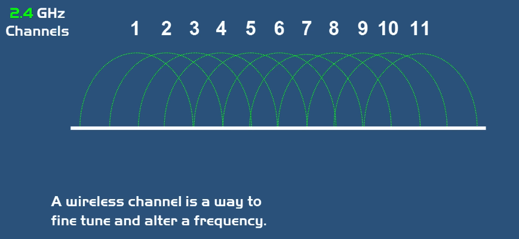
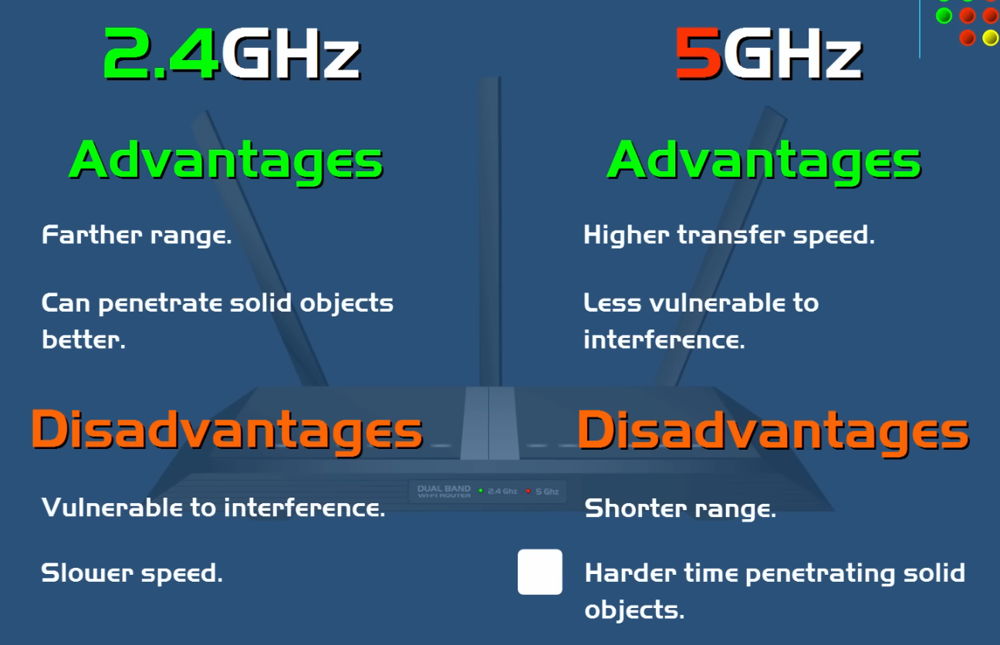

## 6.3 Tri-band и MU-MIMO
- **Single-band** — само 2.4 GHz; **Dual-band** — 2.4 + 5 GHz; **Tri-band** — 2.4 GHz + **две отделни** 5 GHz мрежи (срещу пренасищане; 10–15 устройства се възползват).
- **Smart Connect** — гарантира максимална скорост.

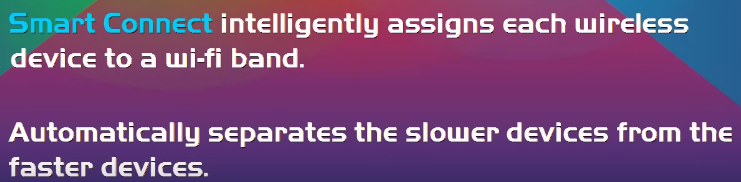

- **MU-MIMO – Multi-User, Multiple-Input, Multiple-Output** — позволява на няколко безжични устройства да комуникират с рутера **едновременно** (сякаш всяко има собствен рутер). Преди: **SU-MIMO (Single-User)**. **Beamforming** — изпраща предавания в различни посоки.

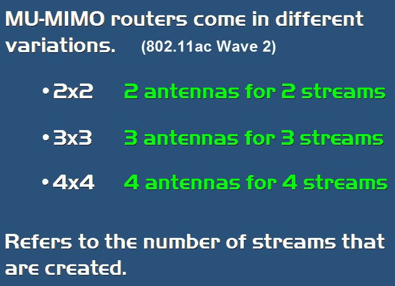
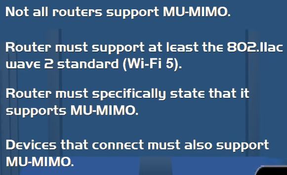

## 6.4 Разширяване на покритието
| Технология | Описание |
|---|---|
| **Wireless Bridge Mode** | Безжично свързва 2 мрежи в 1 (нужни са 2 Wi-Fi рутера, SSID, конфигурация) |
| **Wi-Fi Extender** | Излъчва собствен сигнал (от оригиналния рутер); ⚠️ създава **отделен SSID** |
| **Mesh Wi-Fi** | Група Wi-Fi точки из дома → едно голямо покритие, **един SSID** (най-новата технология срещу мъртви зони) |

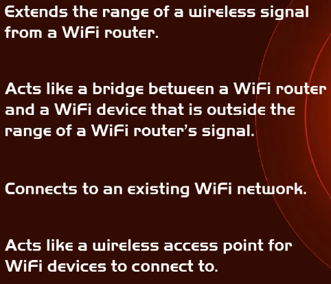

- **SOHO Router** — вграден Switch + безжичен сигнал; рутерът е „вратата“ (Gateway) на мрежата.

## 6.5 Wi-Fi 6 (802.11ax)
Безжичен стандарт от 2019 г. По-бърз от Wi-Fi 5, но скоростта не е основната цел; използва **MU-MIMO** и **WPA3**. При ~20 устройства се възползваме от Wi-Fi 6 рутер.

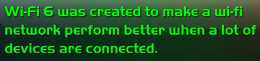
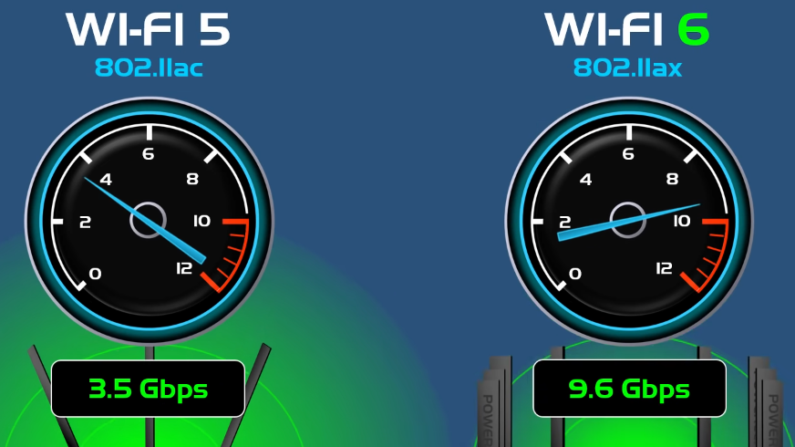
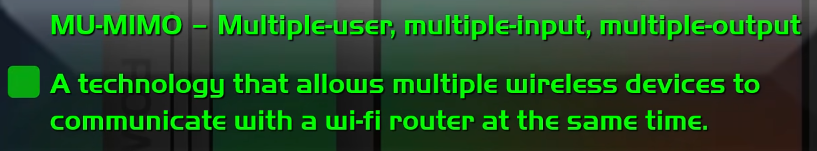
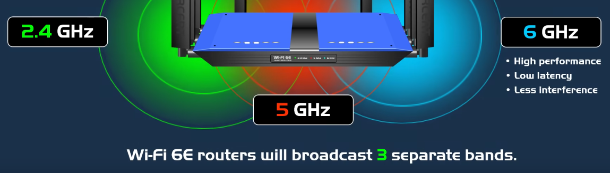

## 6.6 Wi-Fi сигурност (WEP, WPA, WPA2, WPA3, WPS)
| Протокол | Статус | Бележки |
|---|---|---|
| **WEP – Wired Equivalent Privacy** | ❌ Legacy | Остарял, несигурен |
| **WPA – Wi-Fi Protected Access** | ❌ Legacy | Остарял |
| **WPA2** | ✅ Стандарт | Използва **AES** (по-стари устройства може да ползват **TKIP**, който е по-слаб) |
| **WPA3** | ✅ Най-сигурен | Най-ново поколение |
| **WPS – Wi-Fi Protected Setup** | ⚠️ | Най-лесният начин за свързване, но слаба сигурност |

💡 Ако всички устройства са модерни → избери само **WPA2 (AES)**. Опцията „WPA2 + WPA“ е заради стари устройства, несъвместими с AES (ползват TKIP).

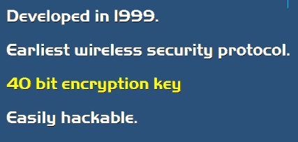
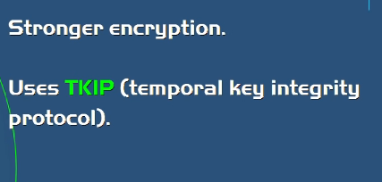
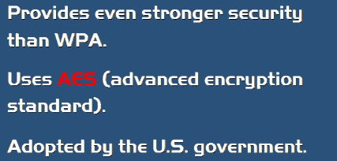
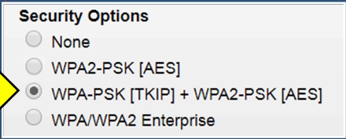
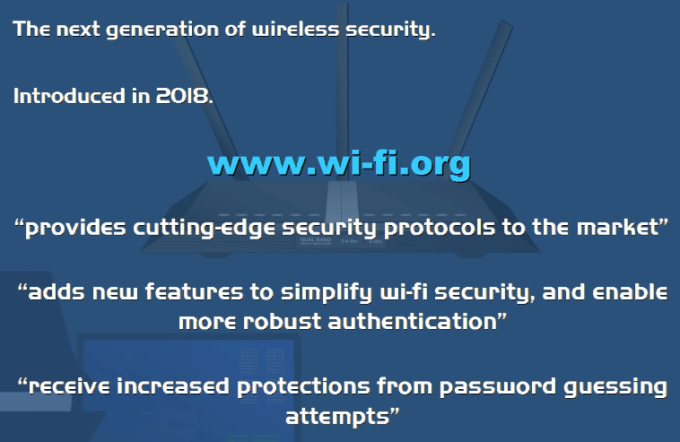

- **Access Control / MAC Filter** — допуска само определени MAC адреси.
- **Guest Network** — отделна гост мрежа от настройките на рутера.

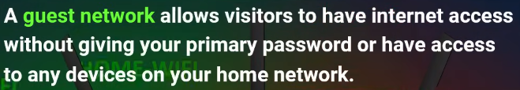

💡 Чести IP адреси за вход в рутер: `192.168.1.1`, `192.168.0.1`, `192.168.2.1`, `192.168.1.254`, `192.168.10.1`, `192.168.8.1`, `192.168.100.1`, `192.168.11.1`.

## 6.7 Bluetooth vs Wi-Fi
И двете са радиочестотни технологии за безжично свързване.
- **Bluetooth** — създаден да премахне кабелите; чип излъчва сигнал за **Pairing (сдвояване)**; основна употреба — безжично аудио; обхват **~10 м**.
- **Wi-Fi** — радиовълни за свързване към Интернет (обикновено чрез Wi-Fi рутер, свързан с ISP); обхват **30–91 м**.

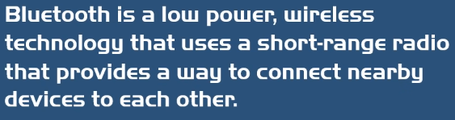
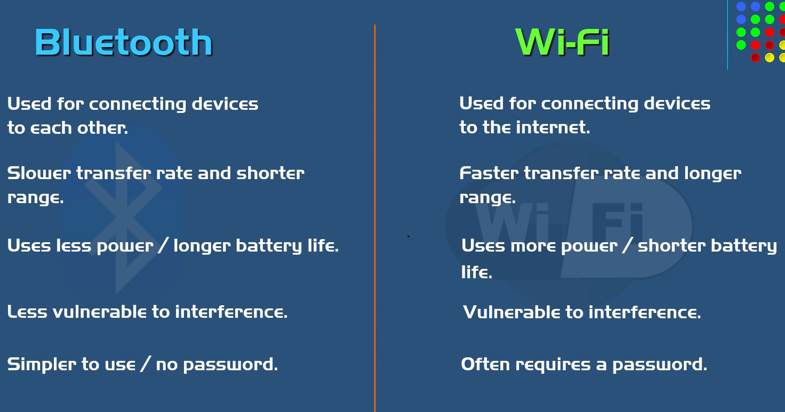

## 6.8 Hotspot
**Hotspot** — физическа **локация**, където можем да се свържем безжично с Интернет (не е хардуер, рутер или смартфон).
- **Public** — кафе, хотел, летище, самолет (понякога с парола).
- **Private** — дом, **Tethering** (създаден от смартфон).
- Създава се от Wi-Fi рутер или WAP, свързан с ISP. Смартфоните ползват **Cellular (клетъчни) мрежи**; **Mobile Hotspot** — преносимо устройство или телефон, ползващо клетъчна мрежа.

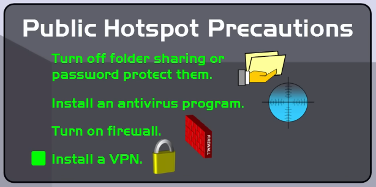

