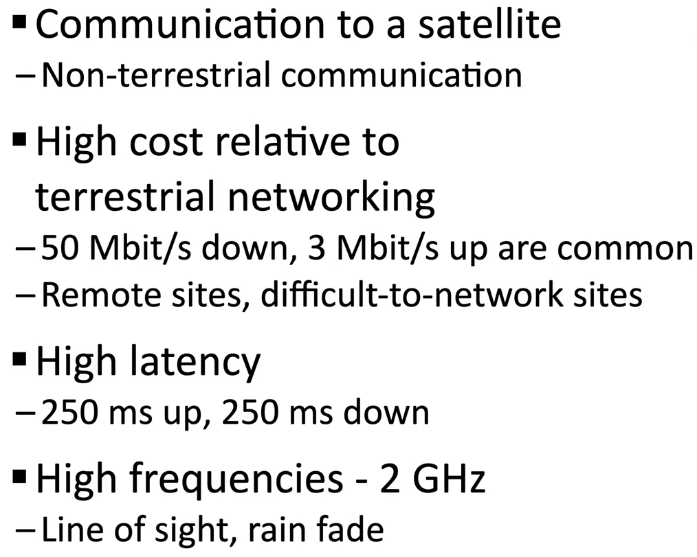
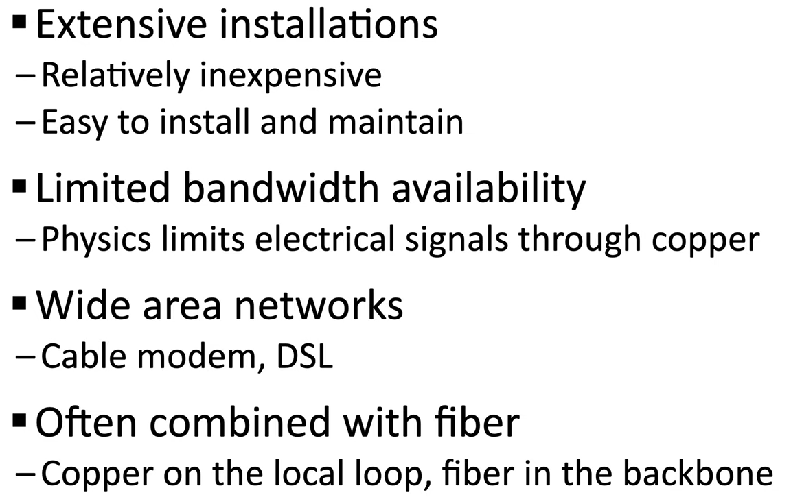
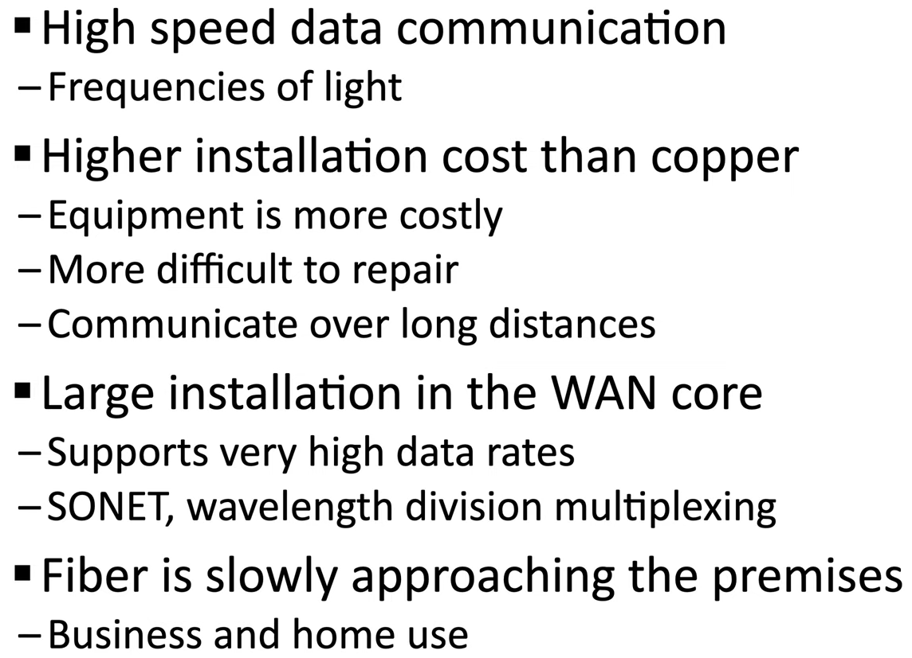
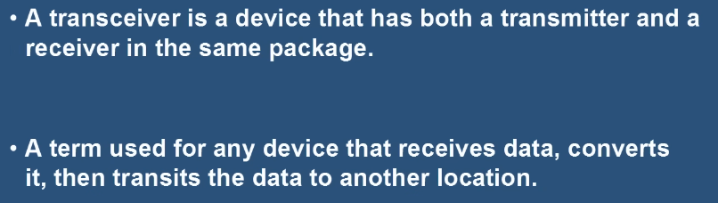

## 7.1 Видове кабели
| Тип | Описание |
|---|---|
| **Copper (медни)** | **Twisted Pair (усукана двойка)** — UTP (unshielded) / STP (shielded); **Coaxial (коаксиален)**; **Twinaxial** |
| **Fiber (оптични)** | Пренос чрез **светлина** (не електрически сигнали); без RF (трудно се подслушва); големи разстояния; имунизиран на RF |
| **Wireless (безжична)** | — |

- **RJ45 Connector** — краят на Ethernet кабела.
- Двата основни типа връзка: **Cable** (мед или оптика) и **Wireless**.

## 7.2 Мрежови конектори
- **LC** – Local Connector
- **ST** – Straight Tip
- **SC** – Subscriber Connector
- **MT-RJ** – Mechanical Transfer Registered Jack
- **UPC и APC**
- **RJ11** (телефон) / **RJ45** (Ethernet)

## 7.3 Provider Links (връзки с доставчика)
- **Satellite Network (сателитна)**
- **Copper (медна)**
- **DSL**, **Cable Broadband / Modem**, **Fiber Optic**, **Metro Ethernet**

Терминология: *Extensive* (обширен), *Bandwidth* (широчина на честотната лента), *Local Loop* (местен контур), *Backbone* (магистрала).

## 7.4 Двоична математика и NIC
- **Bit (Binary Digit)** — 0 или 1 (off/on, false/true).
- **Byte** — 8 бита (често наричан **Octet**).
- **NIC – Network Interface Card** — платка, която свързва компютъра към мрежа.
- **Transceiver (трансийвър)** — предавател-приемник.

