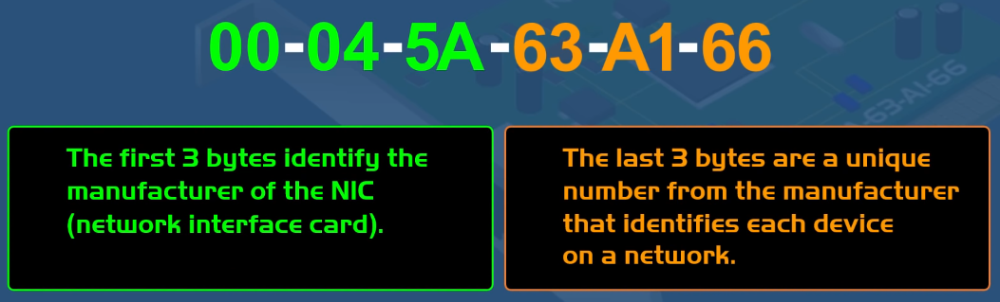
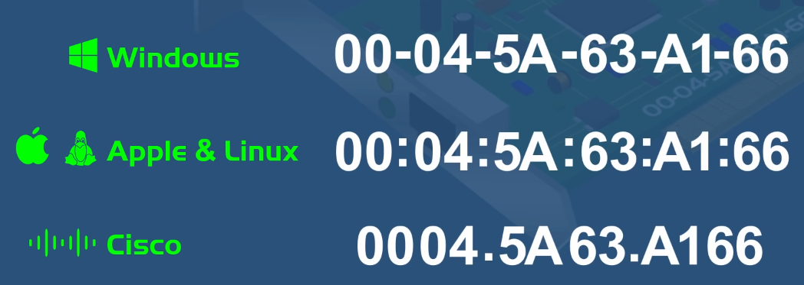
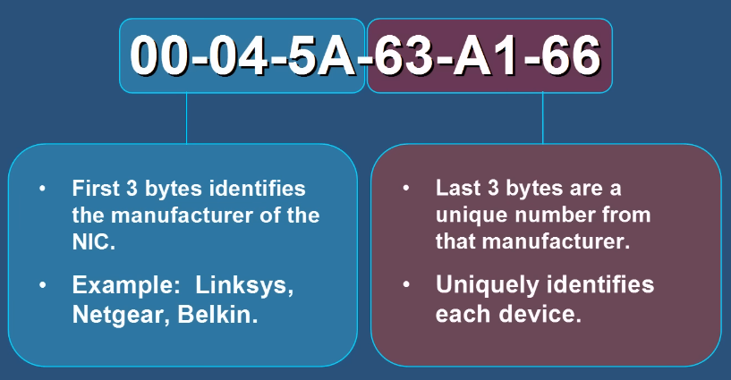

**MAC Address (Media Access Control / физически адрес)** — уникален адрес върху NIC, поставен от производителя. Глобално уникален — няма две устройства с еднакъв MAC.
- Състои се от **48 бита (6 байта)** в hex формат (`XX:XX:XX:YY:YY:YY`):
  - **OUI – Organizationally Unique Identifier** (първите 3 байта) — производителя;
  - **Device ID / NIC** (последните 3 байта) — уникален за устройството.
- 📌 Пример: `00:1A:2B:3C:4D:5E` → OUI `00:1A:2B`, Device `3C:4D:5E`.
- При стартиране на ОС MAC адресът се чете от хардуера, но реално **може да бъде променен (Spoofed)**.

**Ключови роли:** уникална идентификация, адресиране на **Layer 2 (Data Link)**, Ethernet/Wi-Fi комуникация, **ARP** (IP → MAC), мрежова сигурност (MAC filtering — ⚠️ може да се Spoof-не), проследяване.

🎯 **IP vs MAC:**
| | MAC Address | IP Address |
|---|---|---|
| Роля | **IDENTIFY (идентифицира)** устройство | **LOCATE (локализира)** устройство |
| Промяна | Постоянен | Може да се променя (public и private) |
| Слой | Layer 2 | Layer 3 |

- 👉 Мрежовото устройство се нуждае **и от MAC, и от IP** адрес.

- **MAC Address Table** — на Switch-овете; **ARP Table** — на крайните устройства.

