## 9.1 IP Address (Internet Protocol)
Уникален цифров идентификатор, нужен на всяко устройство за комуникация. Състои се от 2 части: **Network Address** и **Host Address**.

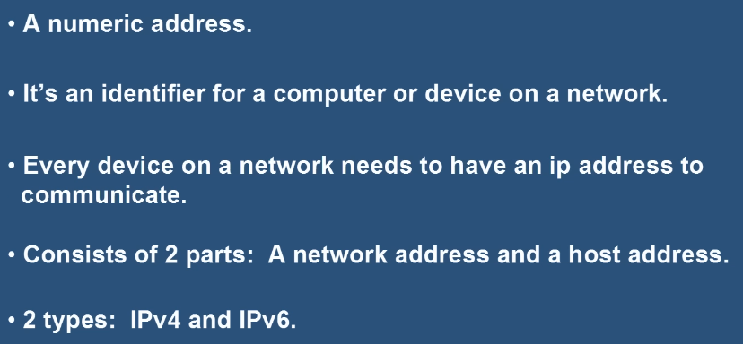

| | IPv4 | IPv6 |
|---|---|---|
| Дължина | **32-битов** | **128-битов** |
| Формат | Десетичен, 4 **октета** (0–255), разделени с точки | Hexadecimal (числа и букви) |
| Капацитет | ~4 милиарда адреса | Практически неизчерпаем |

## 9.2 Subnet Mask (мрежова маска)
Определя коя част от IP адреса е **Network** и коя **Host** — единиците са за Network, нулите за Host. IP адресът винаги върви с маската.

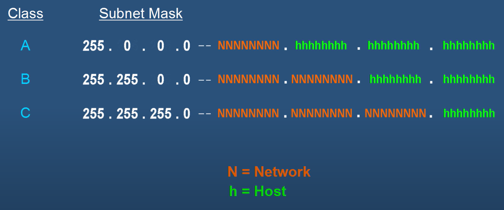
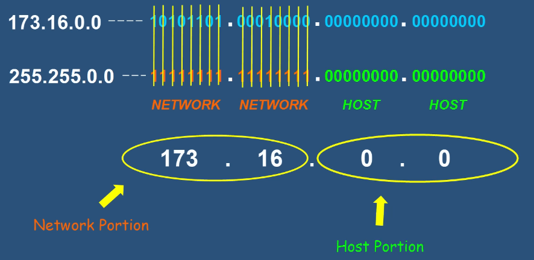

- При маска `255.255.255.0` (/24) → **254 свободни Host адреса** (`11111111` = 255, но не се броят първият и последният).
- 🎯 Два **специални адреса**, които не можем да ползваме:
  - **Network Address** — първият в диапазона (адресът на цялата мрежа — „името на улицата“);
  - **Broadcast Address** — последният в диапазона (за изпращане към всички).
- `255.0.0.0` == `/8`.

## 9.3 IP класове
IP адресите се раздават на организации в блокове, разделени на 5 класа (важни са 3):

| Клас | За кого | Бележки |
|---|---|---|
| **A** | Големи организации | ~16 млн. хоста, 126 мрежи |
| **B** | Средни организации | — |
| **C** | Малки организации / дом | Най-популярният диапазон |
| D | — | Multicast |
| E | — | Експериментален |

- `127` — запазен за **Loopback** (вътрешни функции); `127.0.0.1` = **localhost** (тества дали TCP/IP протоколът на компютъра работи).

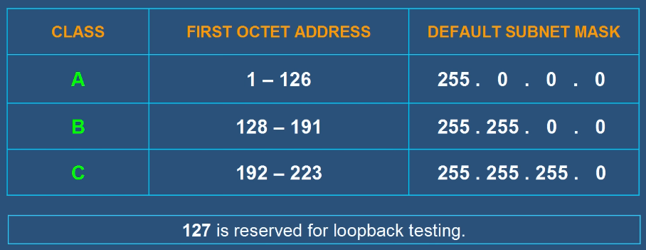

## 9.4 Public vs Private адреси
| | Private IP | Public IP |
|---|---|---|
| Уникалност | Не | Да |
| Интернет | ❌ Директно (нужен **NAT**) | ✅ Публично регистриран |
| Употреба | Вътрешно (дом, училище, офис) | Външно |
| Назначава се от | Router (чрез **DHCP**) | ISP |
| Цена / сигурност | Безплатен, по-сигурен (скрит) | Платен, проследим (Proxy/VPN) |

**Частни диапазони (3 класа):**

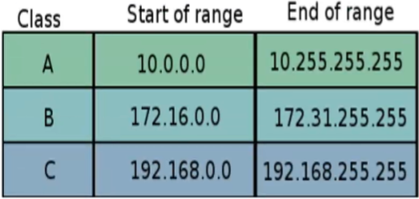
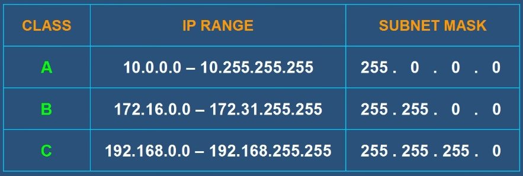
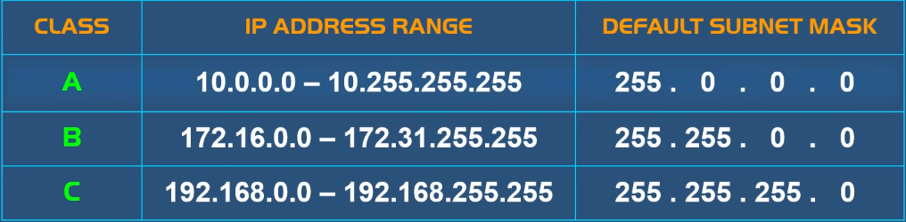
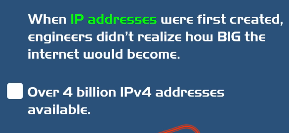

💡 Намиране на IP адреса: Windows → `ipconfig`; macOS/Linux → `ifconfig`.

## 9.5 NAT, SNAT, PAT
- **NAT – Network Address Translation** — услуга в рутерите; преобразува набор IP адреси в друг (частни → един публичен от доставчика). 👉 Решава проблема с недостига на IPv4 адреси — частните адреси се преизползват.

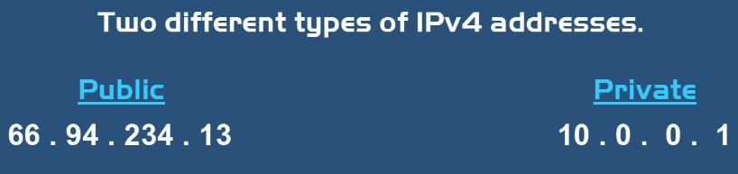

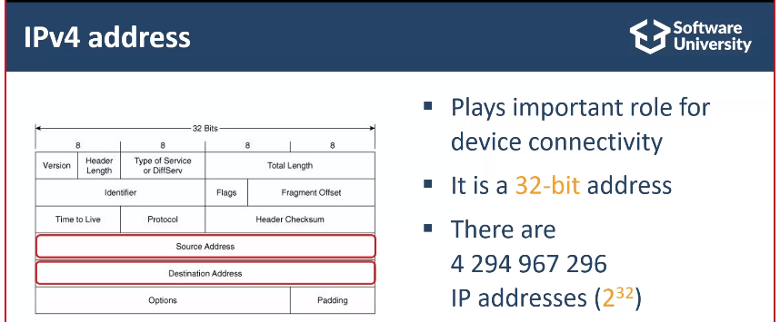
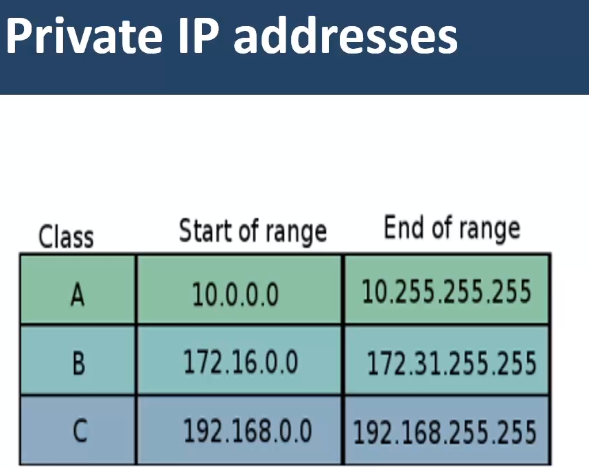

- **SNAT – Static NAT** — свързва публичен IP с частен IP **постоянно** (когато сървър трябва да е достъпен отвън).
- **PAT – Port Address Translation** — преобразува IP адреси на база **Port Numbers**.

## 9.6 CIDR и VLSM
- **CIDR – Classless Inter-Domain Routing** и **VLSM – Variable Length Subnet Mask** — игнорират концепцията за класове; VLSM позволява да раздробим Subnet допълнително.

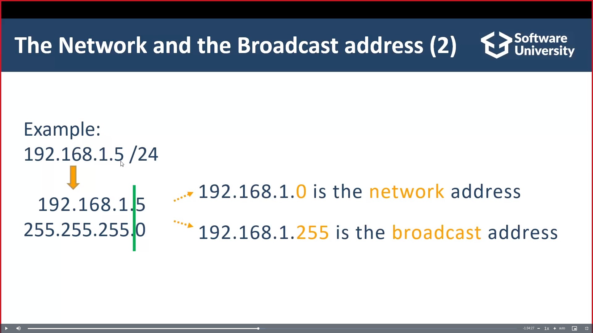

## 9.7 Subnetting
**Subnet (Subnetwork)** — по-малка мрежа в рамките на по-голяма. **Subnetting** — разбиване на голяма мрежа на по-малки (чрез рутери), основно за **Manageability**, Security и Performance. Broadcast сигналите остават в мрежата (не минават през рутер).

## 9.8 APIPA
**APIPA – Automatic Private IP Addressing** — когато устройство **не може да достигне DHCP сървъра**, Microsoft компютрите сами си назначават адрес от диапазона **169.254.x.x** с маска `255.255.0.0`.
- 👉 Позволява връзка в LAN, но не достъпва мрежи с друга маска. Проверка: `ipconfig`. За да няма дублирани адреси, компютрите пращат **ARP** съобщение.

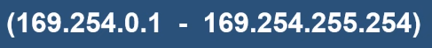

