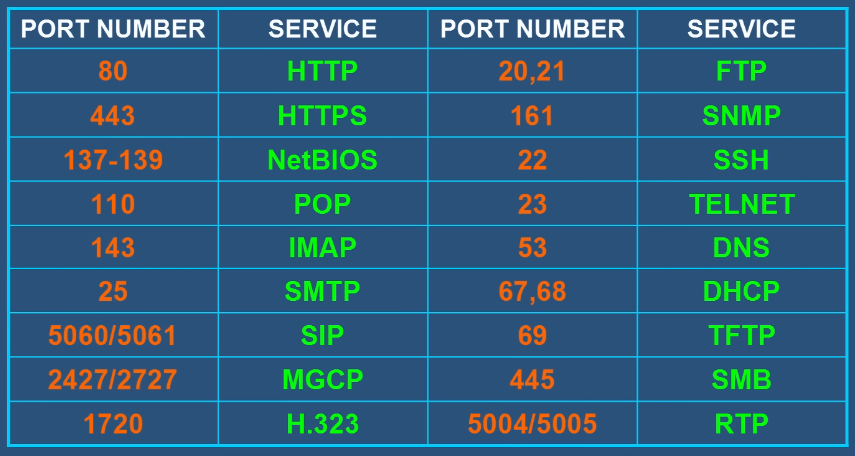
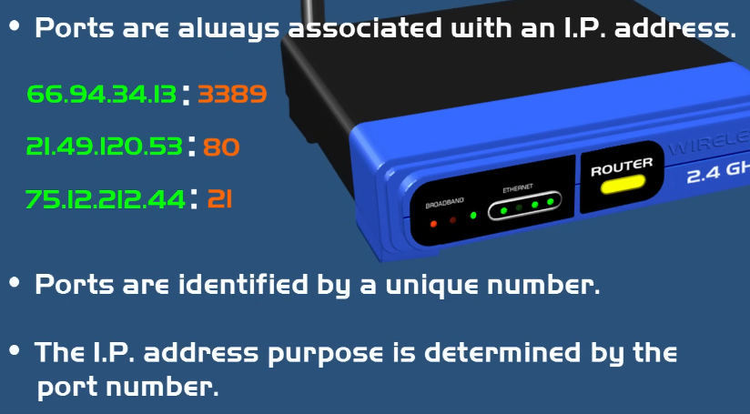
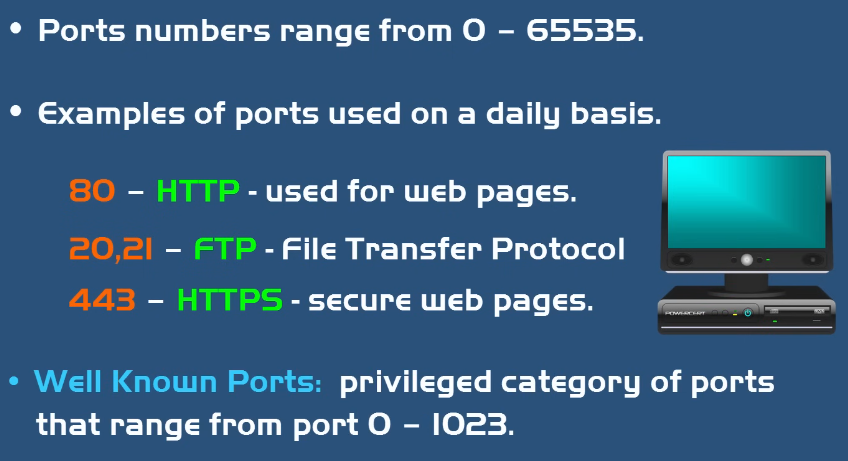

**Port (порт)** — логическа връзка, използвана от програми и услуги за обмен на информация. Уникален номер **от 0 до 65535**. Категоризират се чрез **TCP / UDP**.

| Диапазон | Име | Употреба |
|---|---|---|
| **0–1023** | **Well-known Ports** | Чести услуги (HTTP 80, HTTPS 443, FTP 21, SMTP 25) |
| **1024–49151** | **Registered Ports** | Регистрирани от организации (RDP 3389) |
| **49152–65535** | **Dynamic / Private Ports** | Клиентски приложения при свързване |

**Предназначение:** много услуги на един IP (web на 80, email на 25); насочват трафика към правилната услуга.

## Port Forwarding
Позволява на компютри от Интернет да се свържат с конкретен компютър/услуга във **частна мрежа** — прави те достъпен отвън, въпреки че си зад рутер.
- **Default Gateway** — вътрешният IP адрес на рутера.
- ⚠️ **Security:** отворените портове са риск — атакуващите ги сканират; **Firewall** контролира кои портове са отворени.

