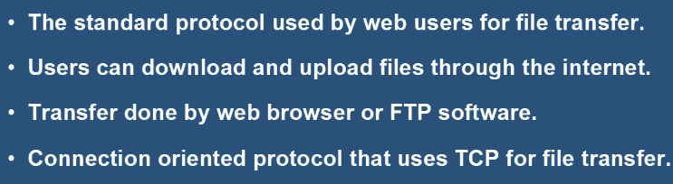
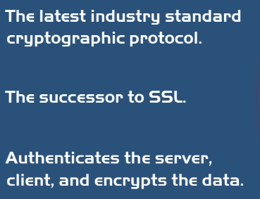
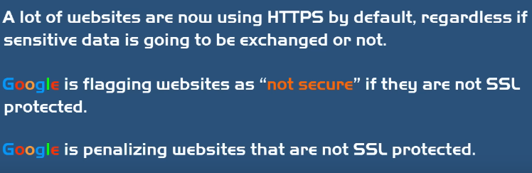
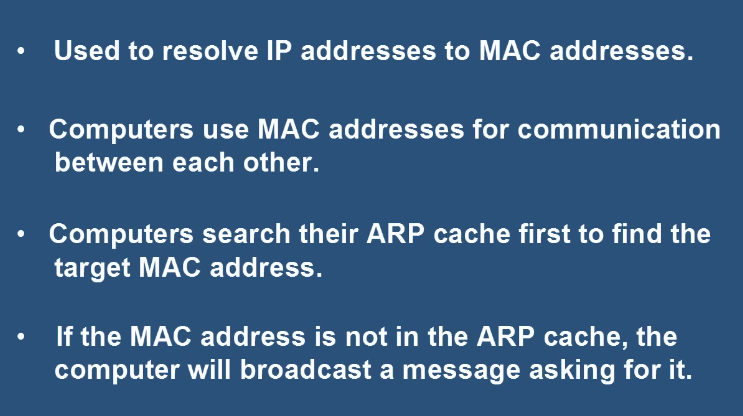

## 12.1 Трансфер на файлове: FTP / SFTP / TFTP
| Протокол | Сигурност | Транспорт | Бележки |
|---|---|---|---|
| **FTP – File Transfer Protocol** | ❌ Clear text | TCP | Прехвърляне на файлове; `ftp.example.com`; клиент: **FileZilla** |
| **SFTP – Secure FTP** | ✅ SSH криптиране | TCP, **порт 22** | Автентикира и потребител, и сървър |
| **TFTP – Trivial FTP** | ❌ | UDP | Много прост; само в LAN (config файлове, firmware); ненадежден |

## 12.2 Email: SMTP / POP3 / IMAP4
| Протокол | Роля | Особеност |
|---|---|---|
| **SMTP – Simple Mail Transfer Protocol** | **Изпращане** на email | TCP, connection-oriented |
| **POP3 – Post Office Protocol** | **Получаване** | Само **сваля** (не синхронизира); изтрива от сървъра |
| **IMAP4 – Internet Message Access Protocol** | **Получаване** | **Синхронизира** email и папки със сървъра (по-добри функции) |

## 12.3 SSH (Secure Shell)
Криптографски протокол за **сигурен достъп до отдалечен компютър/сървър** през несигурна мрежа. Default порт **22** (може и друг).
- Създаден през 90-те, защото **Telnet** и **rlogin** пращат данните в **clear text**.
- Функции: криптирана комуникация, автентикация (пароли, публичен ключ, 2FA), отдалечено администриране, **Tunneling / Port Forwarding**, сигурни трансфери.
- Структура на SSH пакет: Packet Length (4B), Padding Amount (1B), **Payload** (данните), Padding (случайни байтове), **MAC – Message Authentication Code** (валидира автентичността). Подслушвачът вижда само Packet Length и MAC.

## 12.4 SSL, TLS, HTTP, HTTPS
- **HTTP** — най-използваният протокол; разглеждане на уеб страници; праща в **plain text**.
- **HTTPS** — криптира данните чрез:
  - **SSL – Secure Sockets Layer** — public key encryption; **SSL сертификат** удостоверява идентичността на сайта;
  - **TLS – Transport Layer Security** — наследник на SSL.

## 12.5 ARP и RARP
- **ARP – Address Resolution Protocol** — преобразува **IP → MAC**; ползва **Broadcast**. Нужен, защото устройствата комуникират в LAN чрез MAC адреси.
  - Устройството проверява **ARP Cache**; ако няма съвпадение → Broadcast „кой има този IP?“ → отговор с MAC → комуникация.
  - За Ethernet комуникация са нужни 4 адреса: **Source IP, Source MAC, Destination IP, Destination MAC** (изпращачът знае първите 3, получава 4-тия чрез ARP).
  - **ARP записи:** **Dynamic** (автоматични, временни) и **Static** (ръчни, `arp -s`). Проверка: `arp -a`.
- **RARP – Reverse ARP** — обратното: **MAC → IP**.

## 12.6 Други протоколи
- **NTP – Network Time Protocol** — синхронизира времето на компютрите.
- **SCP – Secure Copy Protocol** — ползва SSH за защитен трансфер.
- **SNMP – Simple Network Management Protocol** — управление на мрежата, събиране на данни от устройства.
- **CSMA/CD** (Collision Detection — ранни Ethernet, неактуален) и **CSMA/CA** (Collision Avoidance).

## 12.7 Чести протоколи
HTTP, FTP, SMTP, DNS, DHCP, RDP — дефинират правила и стъпки за обмен на съобщения между устройства.

