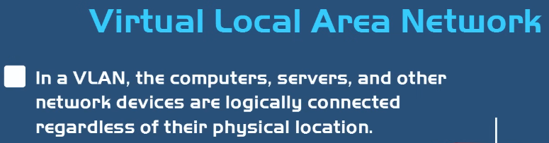
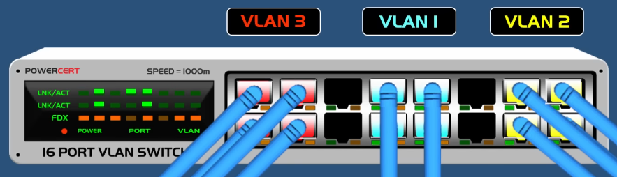
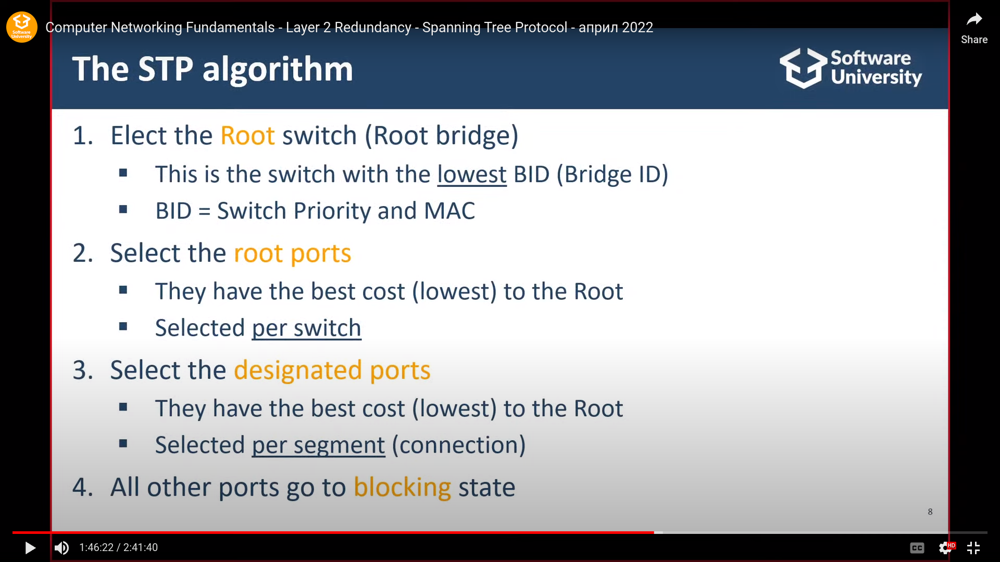

## 13.1 Collision Domain vs Broadcast Domain
| | Collision Domain | Broadcast Domain |
|---|---|---|
| Какво е | Част от мрежата, където пакетите могат да се **сблъскат** | Част от мрежата, където устройствата получават Broadcast сигнали |
| Hub | 1 голям collision domain (всички портове) | Препраща Broadcast |
| Switch | Всеки порт = отделен collision domain (Full-duplex) | Препраща Broadcast |

- 👉 **Broadcast не минава през рутери.** Когато устройство иска да комуникира, първо праща Broadcast, за да намери целевото устройство.

## 13.2 VLAN
**VLAN – Virtual LAN** — логически разделя мрежата на няколко виртуални мрежи върху **VLAN-enabled Switch**.
- **Цели:** подобрена сигурност, управление на трафика, по-проста мрежа, разделяне на broadcast трафика.
- 👉 Различните VLAN-и са **изолирани** и не комуникират помежду си; за връзка между тях → **Layer 3 устройство** (Layer 3 Switch или външен рутер, Inter-VLAN routing).
- **Access Port** — към крайни устройства; frames са **untagged** (устройството не знае към кой VLAN принадлежи); `switchport mode access`.
- **Trunk Port** — пренася няколко VLAN-а.

**vLAN vs Subnet:**
| | Subnet | VLAN |
|---|---|---|
| Разделя | **Физически** (чрез рутери) | **Виртуално** (чрез VLAN switch) |

Общи цели: Performance, Security, Manageability.

## 13.3 STP – Spanning Tree Protocol
Технология на **Layer 2** срещу **broadcast loops**, когато switch-овете са свързани в пирамида (рекурсивно размножаване на broadcast).
- STP логически **блокира** излишни портове. Обикновено е включен по default. Switch-овете комуникират чрез **BPDU – Bridge Protocol Data Unit**.
- **Избор на портове:**
  1. **Root** — критерий: най-нисък **Bridge ID** (Priority + MAC Address);
  2. **Root Port** — на останалите switch-ове; избира се портът с **по-ниска цена** (по-висока скорост → по-ниска цена);
  3. **Designated Ports** — на база връзка/кабел (всички портове към Root са DP);
  4. **All Other Ports Blocked** — единственият порт, който не е DP/RP, се блокира.
- **RSTP (Rapid STP)** — по-бърз, но смята топологията за всички VLAN-и (без разпределение на натоварването); **MSTP, PVST+** решават това.

