## 15.1 Firewall
**Firewall (защитна стена)** — хардуер или софтуер, който разрешава или забранява трафик по определени критерии; предпазва частната мрежа от неоторизиран достъп, като филтрира информацията от Интернет. Създава безопасна бариера между частната мрежа и публичния Интернет.
- **ACL – Access Control List** — лист с правила какво може да достъпи мрежата; разрешава или отказва.
- **Implicit Deny** — default правило: приема само трафик, който ACL допуска.

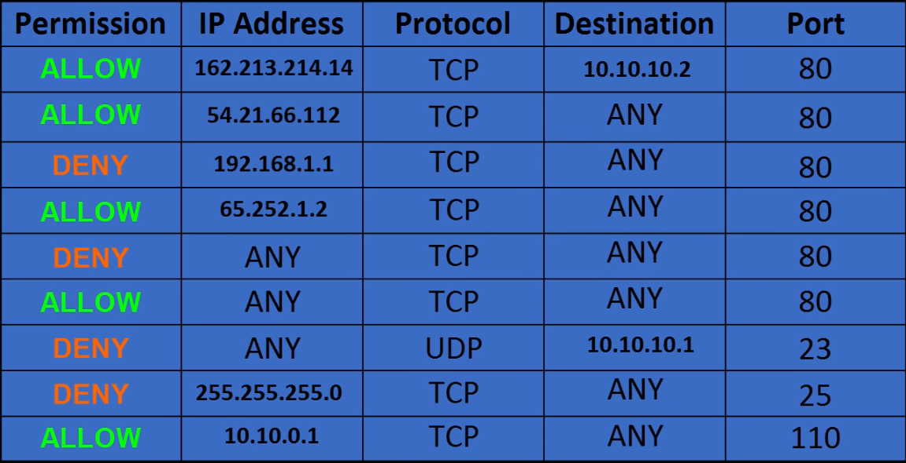
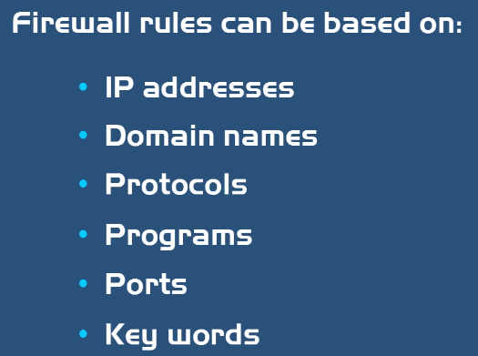

**Видове:**
| Тип | Описание |
|---|---|
| **Host-based (Software) Firewall** | Инсталиран на компютър — защитава само него |
| **Network-based Firewall** | Софтуер + хардуер; на Network Layer; между частна мрежа и Интернет — защитава цялата мрежа (stand-alone или вграден в рутер) |

**Stateful vs Stateless:**
| | Stateful | Stateless |
|---|---|---|
| Как | Проследява всички връзки, пази Log, защитава динамично | Ползва ACL за разрешаване/отказ |

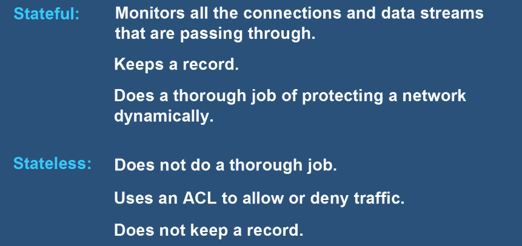

- **Content Filtering** — филтрира по съдържание (напр. email spam).
- **Signature Identification** — открива вируси с познат поведенчески модел.
- **IDS/IPS – Intrusion Detection / Prevention System** — хардуер/софтуер между Firewall и Интернет; наблюдава трафика за подозрителни модели.

## 15.2 DMZ (Demilitarized Zone)
Подобрява сигурността, като разделя устройствата от двете страни на Firewall (сякаш 2 отделни мрежи). По-сигурните DMZ имат **поне 2 Firewall-а**. Устройството в DMZ се конфигурира със **статичен IP**.

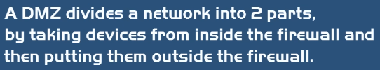
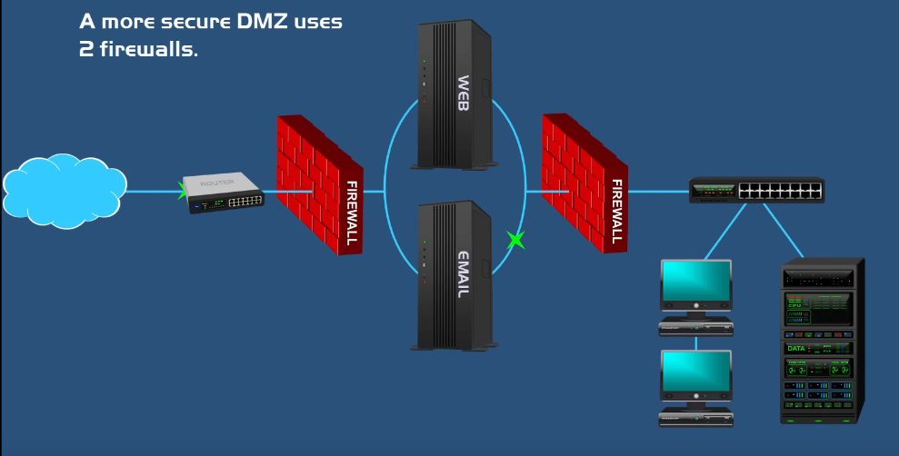

## 15.3 Proxy Server
**Proxy Server** — сървър, който извлича данни от Интернет **от името на потребителя** (middle man).
- **Защо:** скрива нашия IP, **Speed** (кешира страници в централна DB), **Activity Logging** (фирмите следят кои сайтове посещават служителите, могат да блокират сайтове).
- ⚠️ Proxy **не криптира** данните — за това идва **VPN** (скрива IP + криптира; създава сигурен тунел).

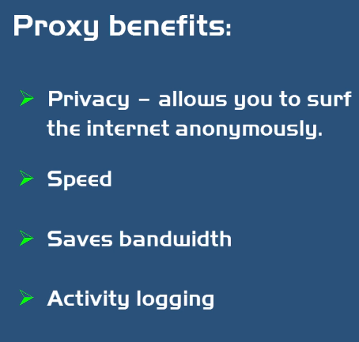

**Видове proxy:** HTTP, SSL (HTTPS), FTP, SOCKS, Transparent, Reverse, Anonymous.

**Proxy vs Reverse Proxy:**
| | Forward Proxy | Reverse Proxy |
|---|---|---|
| Защитава | **Клиентите** | **Сървърите** |
| Прави | Блокира сайтове, скрива IP на клиентите, логва активност, достъп до ограничено съдържание, кеширане | Скрива IP на сървърите, блокира зловреден трафик (DDoS), **Load Balancing** |

## 15.4 IPsec
**IPsec** — защитава данните чрез **Authentication** и **Encryption**, като създава сигурни тунели. Работи в 2 стъпки чрез **IKE – Internet Key Exchange**. Нужни са публични и частни ключове.
- **Transport Mode** — между 2 устройства (напр. 2 компютъра) през публичния Интернет;
- **Tunnel Mode** — между 2 сайта (напр. 2 фирми) през VPN.

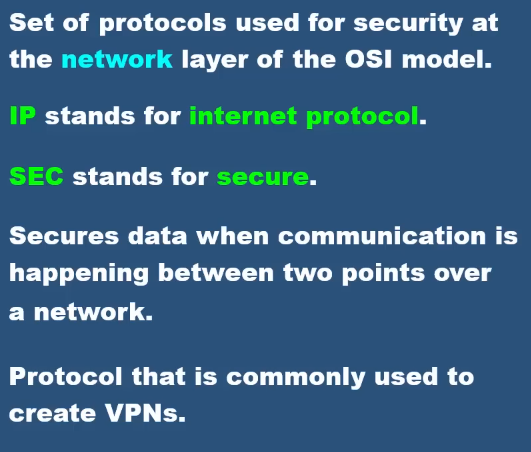
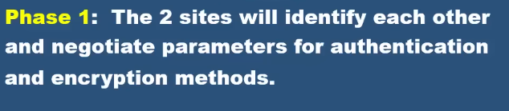
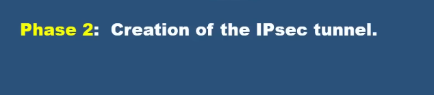
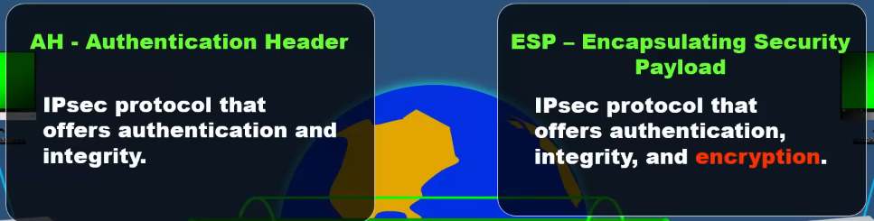
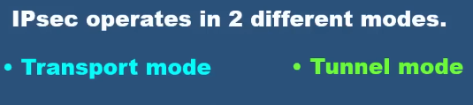
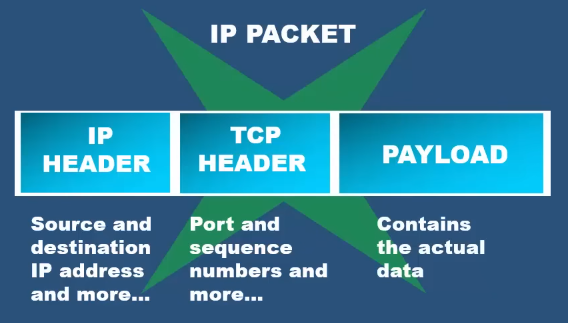
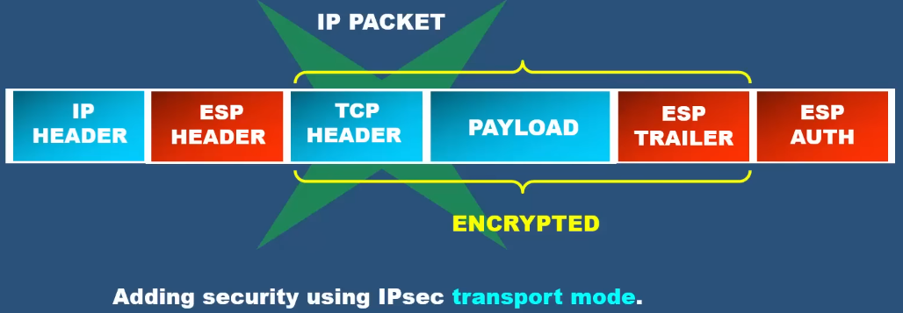
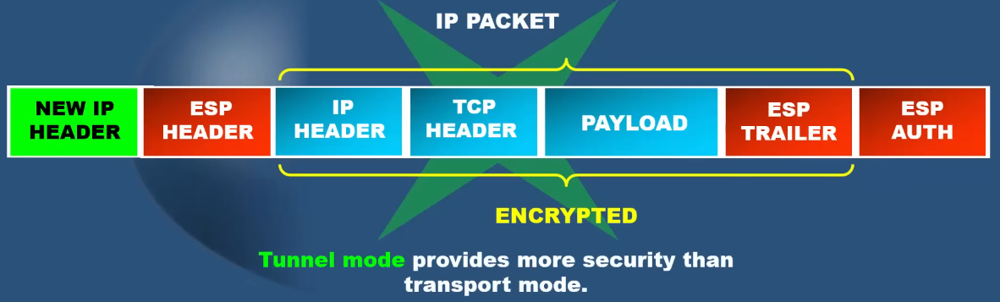

## 15.5 Server vs Desktop
**Server (сървър)** — специализиран компютър, който предоставя услуги от името на клиентите (централизирана машина, към която клиентите се свързват за конкретна услуга).
- 👉 Сървърът е **роля**, която компютърът поема — всеки desktop може да бъде setup-нат като сървър.
- Сървърите са надеждни, работят 24/7 с малко downtime; ползват **Server OS** (Linux, Windows Server, macOS Server).
- Примери: Web Server (хоства сайт), Email Server (IMAP/POP/SMTP), Database Server.

## 15.6 Circuit (верига)
- **Circuit** — специализиран комуникационен път между две крайни точки с фиксирана връзка/честотна лента (физически или виртуален). В традиционните мрежи — наети линии между офиси/дейта центрове.
- 📌 **Azure ExpressRoute Circuit** — частна, специализирана връзка от on-premises мрежата към Azure (dedicated bandwidth, частен път извън Интернет, обвързан с доставчик и регион).

