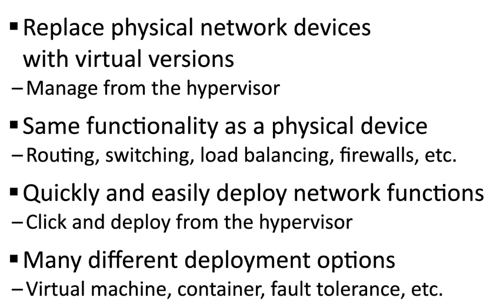

С виртуални сървъри не са нужни 100 физически машини — можем да пуснем 100 виртуални сървъра на 1 физически чрез **Hypervisor**.
- **NFV – Network Function Virtualization** — виртуализира функции (routing, switching, load balancing, firewalls).
- **Hypervisor (Virtual Machine Manager)** — управлява виртуалната платформа и гост ОС; Hardware Management; Single Console Control.
- **vSwitch** — премества физическия switch във виртуалната среда.
- **vNIC – Virtual NIC** — виртуален мрежов интерфейс (конфигурира се през hypervisor-a).

