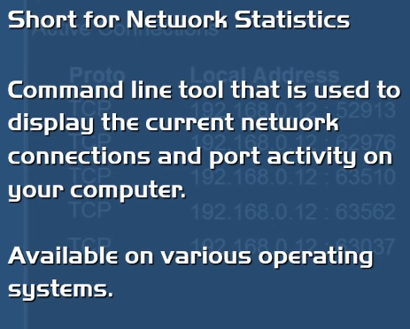
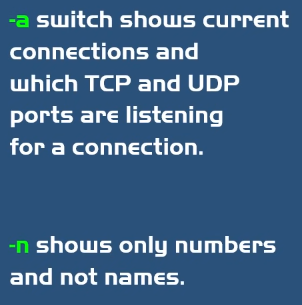

## 17.1 Ping
**Ping** — проверява свързаността чрез протокола **ICMP** (Echo Request → Echo Reply). Казва дали сървърът е онлайн, времето за отговор и има ли загубени пакети (но не и причината за проблема).
- **ICMP – Internet Control Message Protocol** — за докладване на грешки и диагностика (ползва се от traceroute и ping).
- Windows праща 4 пакета; Linux пинг-ва безкрайно по default.
- `ping <ip/domain>`, `ping -c 4 8.8.8.8` (проверка за Интернет на сървър без браузър), `ping -f -l 1472 8.8.8.8` (don't fragment, length).

## 17.2 Traceroute
**Traceroute** — показва маршрута (всеки рутер / **Hop**) на пакетите до дестинацията, и времето за всеки hop. За разлика от ping, пинг-ва **всеки рутер** по пътя (ping — само дестинацията).
- **TTL – Time to Live** — стойност, която пречи на пакета да обикаля безкрайно; при всеки hop намалява с 1; при 0 → ICMP Time Exceeded, source праща нов пакет с TTL+1.

## 17.3 Netstat
Показва активните мрежови връзки и портове.
- `netstat -n` — без DNS (само IP, по-бързо);
- `netstat -a` — активни връзки + слушащи TCP/UDP портове;
- `netstat -b` — коя програма прави връзката;
- `netstat -f` — FQDN в колоната Foreign Address;
- `netstat -bf` / `-an` — комбинации.

## 17.4 Telnet vs SSH
- **Telnet (Teletype Network)** — terminal emulation за отдалечен достъп; ⚠️ **clear text, без криптиране** — може само в LAN, не през публичния Интернет; за старо оборудване без SSH.
- **SSH** — сигурната алтернатива (криптиране + автентикация).

## 17.5 Други
- `ipconfig` (Windows) / `ifconfig` (Linux/macOS) — мрежова конфигурация.
- `arp -a` — ARP таблица.

