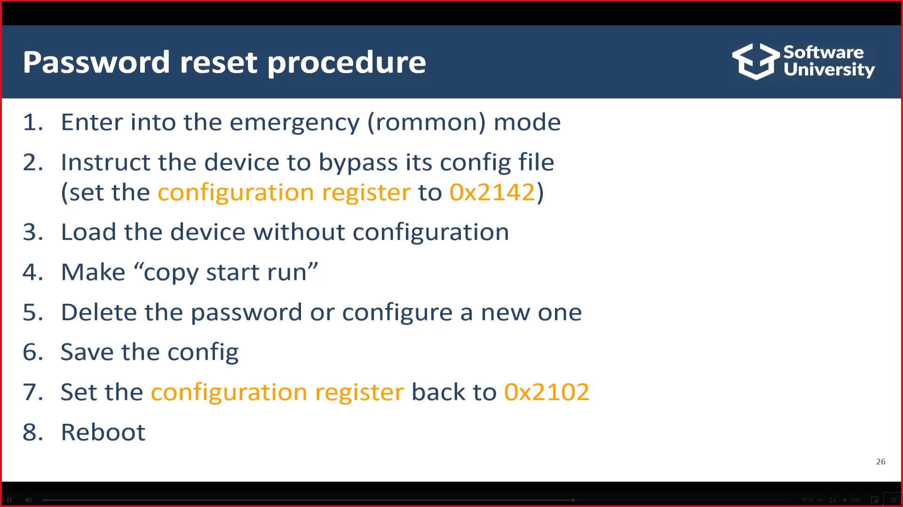
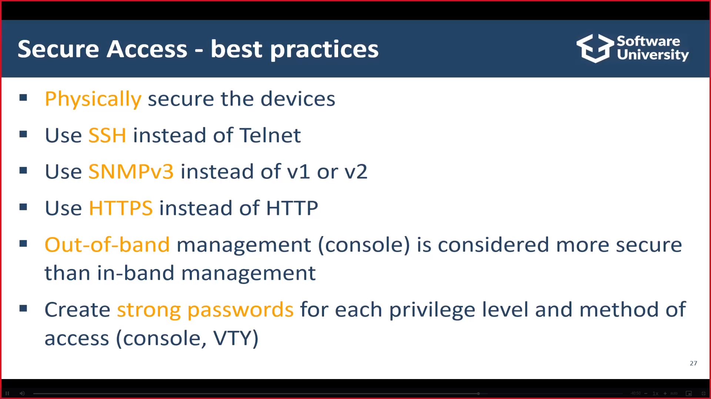

## 18.1 Компоненти (памет)
| Компонент | Роля | Енергозависимост |
|---|---|---|
| **RAM** | Текуща конфигурация / промени (**Running Config**) | ⚠️ Енергозависима |
| **NVRAM** | Запазена конфигурация (**Startup Config**) | Пази без ток |
| **Flash Memory** | ОС/Image на устройството | Пази без ток |
| **ROM** | Мини-Image (като BIOS), който извиква главния Image | Пази без ток |

## 18.2 Запазване на конфигурацията
- `copy run start` (= `copy <source> <dest>`) или `write memory` — запазват **Running Config (RAM) → Startup Config (NVRAM)**.
- При рестарт устройството чете Startup Config (NVRAM) и го копира в Running Config (RAM).

## 18.3 Достъп за управление
| Метод | Описание |
|---|---|
| **Out-of-band** | Отделен **Console Cable (конзолен кабел)** само за управление |
| **In-band** | Същият кабел, който ползваме за Интернет |

- **Telnet** — in-band, лесен, но ниска сигурност; **SSH** — по-сигурен; **SNMP** — ползва се от софтуер за управление.
- **Physical Security** — конзолният кабел изисква физическа близост; устройствата трябва да са с пароли.

## 18.4 Пароли и привилегии
- Парола за privilege exec режим: `enable password` или **`enable secret`** (препоръчителна — тип 5 криптиране, hash).
- Смяна на име: първо `conf t` (configure terminal, глобален конфигурационен режим).
- Логически интерфейси за защита: **Privileged режим, Console достъп, VTY достъп**.
- **Privilege Levels:**
  - **1** — user exec mode (`>`);
  - **15** — privileged exec mode (`#`, read-write);
  - между 1 и 15 — персонализирани (напр. ниво 10 с определени команди).

**Password Reset:**

